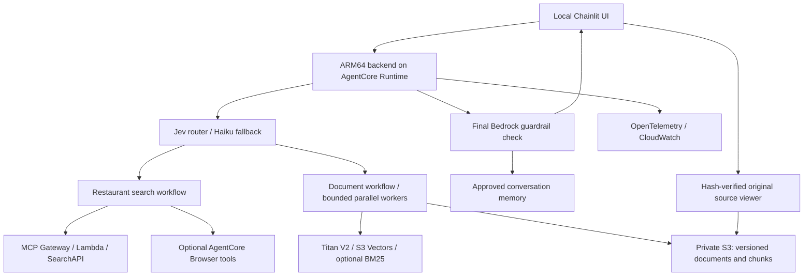

# Restaurant Finder: agent workflows, document RAG and AWS deployment

An AI engineering portfolio project using **LangGraph**, **Amazon Bedrock AgentCore**, and **Chainlit**. It finds restaurants through web search, answers bounded questions from versioned menu/policy documents, and lets users inspect cited originals. The Python backend runs in an ARM64 container on AWS; the demonstrated Chainlit interface runs locally and calls that cloud backend.

Adapted from [Joud Awad's original project](https://github.com/JoudAwad97/agentic-ai-langgraph-and-aws-agentcore). This repository extends that foundation; it does not claim authorship of the original application. It is a demonstration, not an operated production service.

## Demo

[Download the original MP4 (21 MB)](https://github.com/yukangzhen/restaurant-finder/releases/download/demo-walkthrough/restaurant-finder-demo.mp4)

Silent, 55 seconds, 1080p. The walkthrough shows restaurant discovery, cited menu comparison, a contextual follow-up and AWS deployment/tracing evidence.

## Architecture



The API buffers the answer for final moderation before sending a complete SSE text chunk. This is not token-by-token output streaming. Prompt synchronization is an explicit deployment operation, separate from application startup. CDK defines ECR, RAG and AgentCore stacks; regional trace-destination setup is a separate account operation.

## Get started

```powershell
git clone https://github.com/yukangzhen/restaurant-finder.git
Set-Location restaurant-finder
```

| Goal | Guide | AWS credentials / charges |
| --- | --- | --- |
| Inspect code and run offline checks | [Setup: offline checks](docs/SETUP.md#2-offline-checks) | No AWS login or inference; dependency downloads require internet. |
| Deploy in your own AWS account | [Setup: first AWS deployment](docs/SETUP.md#3-first-aws-deployment) | Required; creates resources and can incur charges. |
| Use a local UI with an existing cloud backend | [Setup: connect the UI](docs/SETUP.md#4-connect-the-local-ui-to-aws) | Required; requests use billable AWS/provider services. |
| Run the backend locally | [Setup: local API](docs/SETUP.md#5-optional-local-api) | Still uses AWS models, gateway, memory and optional document stores. |

Use **Python 3.11.9+ within 3.11**, **uv**, and **Node.js 22** for the documented checks. AWS deployment also needs a working AWS CLI/profile, Docker with ARM64 build support, Bedrock model access, and a SearchAPI key. A TypeSafe key enables Jev; without it the router uses Bedrock. The [setup guide](docs/SETUP.md) specifies paths, prerequisites, feature switches, secrets, ingestion, ports and verification boundaries.

## Documents and the recorded demonstration

The demonstration connects discovery of vegetarian-friendly Italian restaurants in Kuala Lumpur with document questions about Ciccio and Bottega. Their menu documents were reviewed and ingested separately; restaurant search does not automatically collect or ingest documents.

The real-source catalog and validation code are committed, but the privately prepared third-party corpus is **not** bundled. A captured web-page PDF is labeled as a capture, not as an original restaurant-issued PDF. The committed [sample corpus](restaurant-finder-api/sample_documents/corpus.json) instead provides six fictional menu/policy documents for Harbor Pasta Lab, Sakura Table Lab and Spice Garden Lab. Use those fixtures for a reproducible setup.

Discovery can return restaurants outside the active document corpus. Missing cancellation-policy evidence is reported as insufficient evidence; it does not mean free cancellation or no cancellation policy. Prices describe captured documents, not guaranteed current offers.

## Configuration at a glance

| Setting | Local API default | CDK Runtime default |
| --- | --- | --- |
| `DOCUMENT_RAG_ENABLED` | `false` | `true`; requires an activated corpus |
| `DOCUMENT_MULTIPART_ENABLED` | `false` | `false`; context `documentMultipartEnabled=true` |
| `DOCUMENT_FOLLOWUPS_ENABLED` | `false` | `false`; context `documentFollowupsEnabled=true` |
| `DOCUMENT_REAL_SOURCES_ENABLED` | `false` | `false`; context `documentRealSourcesEnabled=true` |
| `RAG_RETRIEVAL_MODE` | `vector` | `vector`; context `ragRetrievalMode=hybrid` |
| `AGENT_OBSERVABILITY_ENABLED` | `false` | `true`; export still needs account configuration |
| `REQUIRE_PROMPT_MANIFEST` | `false` | `true` |

See the [API environment example](restaurant-finder-api/.env.example), [UI environment example](restaurant-finder-ui/.env.example), and [CDK entry point](restaurant-finder-infra/bin/cdk.ts). The setup guide explicitly enables multipart/follow-ups/hybrid for the fictional walkthrough. Real-source mode needs a separately reviewed compatible corpus.

## Repository map

```text
restaurant-finder-api/
  src/application/orchestrator/   Parent LangGraph workflow, routing and web tools
  src/application/document_rag/   Ingestion, retrieval, comparisons and follow-ups
  src/domain/                     Contracts, catalogs and prompts
  src/infrastructure/             AWS/provider adapters, safety and observability
  src/deployment/                 Prompt sync and explicit corpus preparation/publication
  src/evaluation/                 Offline regressions and separate live evaluators
  sample_documents/               Reproducible fictional fixtures
  tests/                          API and workflow regressions
restaurant-finder-ui/             Chainlit app, SSE handling and original-source viewer
restaurant-finder-infra/          CDK stacks and SearchAPI Lambda
.github/workflows/               Offline CI and manual deployment/destruction
docs/                            Setup, document RAG and evaluation guides
```

## Verification and deployment

The [offline CI workflow](.github/workflows/ci.yml) runs API/UI tests, five document evaluations, TypeScript compilation, Jest and CDK synthesis without AWS lookups. Evaluations exercise real workflow/validation code with simulated cloud and model dependencies; they do not measure live model accuracy, retrieval recall, latency or cost.

See [CI results for main](https://github.com/yukangzhen/restaurant-finder/actions/workflows/ci.yml?query=branch%3Amain) for current checks. Match a run's commit SHA to the revision you are inspecting; results for an older revision do not establish a pass for later changes.

Image and infrastructure deployment workflows are **manual-only** in this revision. Offline CI remains automatic on pushes/PRs. The manual infrastructure workflow does not pass all document feature contexts; use the [reviewed CDK commands](docs/SETUP.md#3-first-aws-deployment) for the documented walkthrough. [Cleanup](docs/SETUP.md#7-cleanup-and-retained-resources) leaves retained resources that may continue to incur charges.

## Limits and known issues

- Document support is bounded: one/two restaurants, admitted menu-price/cancellation forms, at most six documents and 48 chunks per generation. OCR and arbitrary table reconstruction are unsupported.
- The UI is a local controlled demo. Caller-provided actor/session IDs and access to the source bucket are not authentication or document-level authorization for a shared public service.
- A source-viewer interaction has shown a mismatched original; that association issue remains unresolved. Independently inspect restaurant, document and quotation before relying on a citation.
- CloudWatch can contain prompts/results. Keep trace/log access restricted and choose suitable retention. Dashboard/indexing availability depends on regional account configuration.
- No production availability, measured cost reduction, general answer-accuracy score or fresh-account deployment certification is claimed.

## Further reading and attribution

- [Canonical setup instructions](docs/SETUP.md)
- [Document RAG engineering guide](docs/DOCUMENT_RAG.md)
- [Offline checks and evaluation interpretation](docs/CI_AND_RAG_EVALUATION.md)
- [Backend](restaurant-finder-api/README.md), [UI](restaurant-finder-ui/README.md), [infrastructure](restaurant-finder-infra/README.md)
- [Original repository](https://github.com/JoudAwad97/agentic-ai-langgraph-and-aws-agentcore) and [author's walkthrough](https://joudwawad.medium.com/production-ready-ai-agent-from-scratch-with-langgraph-aws-agentcore-e236cd3f675f)

Neither this repository nor upstream had an identified license file at review time. No new license covering inherited code or third-party documents is asserted here.
