# Document RAG engineering guide

Use [Setup](SETUP.md) for current commands and the [evaluation guide](CI_AND_RAG_EVALUATION.md) for offline checks. Historical rollout records describe observations at their own dates; they do not establish current Runtime state.

## What this adds

The original project used web/browser tools and conversational memory. This fork adds a separate `document_qa` route with immutable document generations, restaurant-scoped retrieval, verified quotations and inspectable originals. Jev classifies ordinary intent; Haiku is the fallback. Recognized opt-in follow-ups can resolve scope deterministically. Conversation memory is separate from the document corpus.

The reproducible corpus is `restaurant-finder-api/sample_documents/corpus.json`: six PDF/Markdown documents for three fictional venues. `corpus-v2.json` changes Harbor's mushroom pasta price from RM28 to RM32. Nothing is uploaded until explicit publication. The real-source catalog includes venues used in the video, but its privately reviewed originals/research are not committed.

## Ingestion

```mermaid
flowchart LR
    Source[Reviewed catalog and original bytes] --> Extract[Bounded PDF / Markdown extraction]
    Extract --> Chunk[Whole records / stable hashes]
    Chunk --> Plan[Offline generation plan]
    Plan --> Embed[Compatible cache or Titan V2]
    Embed --> Stage[S3 generation / S3 Vectors]
    Stage --> Verify[Verify stored chunks and query readiness]
    Verify --> Active[Conditional active-pointer publication]
```



From the API directory, after locked dependency installation:

```powershell
uv run --no-sync python -m src.deployment.ingest_documents --dry-run --corpus sample_documents/corpus.json
```

Dry-run creates no AWS clients. The paid `--publish` operation additionally needs `--profile`, `--region us-east-2`, `--bucket`, `--index-arn` and an embedding-attempt budget. Use the complete [deployment instructions](SETUP.md#3-first-aws-deployment), not copied account values from old runbooks.

The active pointer is written last with a conditional ETag/absence check. This coordinates publication across services; it is not a cross-service atomic transaction. Retained generations support in-flight answers and rollback. Repeating a complete active generation avoids new embeddings/vector writes. Reusable embeddings must match canonical text, model, dimensions and normalization.

Publication/rollback require owner credentials. Runtime read IAM permits the active pointer, manifests/chunks, vector queries and Titan invocation; it does not permit reading original source objects or writing the corpus. The local UI has separate source-read credentials.

## Source contracts and real documents

Corpus schema 1 supports fictional fixtures. Schema 2 adds real-venue identity and reviewed provenance. Provenance distinguishes restaurant-issued `official_pdf` documents from captured booking/menu web pages (`booking_page_snapshot`, `booking_page_pdf`, `menu_page_pdf`). A rendered web-page PDF is a snapshot, not an official PDF issued by the restaurant.

Real venues require a matching trusted catalog, source URL/capture/hash metadata and compatible image/prompts/flags. Native menu support uses reviewed bounded row anchors and currency evidence; it does not infer arbitrary tables. Restaurant-issued native menus retain required charge notes; captured menu-page PDFs may explicitly have no charge note, without inventing one.

`prepare_real_demo` and `prepare_discovered_demo` consume previously reviewed private files. They do not discover/download/approve arbitrary documents. The latter admits the two reviewed Ciccio/Bottega menu additions to a compatible retained base. A new unrestricted restaurant search may find different venues with no corpus coverage.

See the current contracts in [document_rag.py](../restaurant-finder-api/src/domain/document_rag.py), extraction limits in [document_parser.py](../restaurant-finder-api/src/infrastructure/document_parser.py), and native row handling in [native_menu.py](../restaurant-finder-api/src/application/document_rag/native_menu.py).

## Retrieval and answer validation

Each answer pins one active generation. Retrieval scopes candidates by generation, restaurant and optional document type, then verifies stored text, hashes and metadata. The quote selector admits exact source substrings; trusted rendering attaches generation, document, chunk, hash and page/section/line metadata. Ordinary answers can retain up to three quote selections. Multipart responses support at most four cited tasks.

Single-record completion can extend an authentic shortened menu/policy anchor to its full unambiguous record in the same retrieved passage, retaining qualifiers. It performs no extra I/O/model call. Forged text, conflicting records and unknown boundaries are rejected.

Answer text is buffered and passes the parent output guardrail before citations/context are published and approved text is saved. Masked/blocked responses cannot silently advance document context. This is extractive, bounded document QA, not unrestricted answer generation or a universal relevance guarantee.

## Hybrid retrieval

`RAG_RETRIEVAL_MODE=vector` is the default. Optional `hybrid` combines:

1. Titan V2 / S3 Vectors semantic candidates.
2. Local BM25 ranking of scoped manifest passages, with NFC normalization, case folding, Unicode tokens, k1=1.2 and b=0.75.
3. Reciprocal Rank Fusion (constant 60), deduplication and deterministic tie ordering.

Both branches share the pinned generation and source checks. Hybrid allows at most five candidates per branch, ten union candidates, five returned whole passages and 9,000 context characters. Extra candidate verification may add chunk reads. An empty successful vector response can still admit keyword evidence; a provider failure is not silently converted into success. Ranking/fusion scores are not factual confidence.

The local BM25 branch needs no additional search service or persistent index. Offline evaluations use simulated semantic/model responses and do not prove improved live recall, latency or cost.

## Comparing document menu prices

A bounded comparison names one exact item and two different catalog venues, for example:

```text
Compare mushroom pasta prices at Harbor Pasta Lab and Sakura Table Lab. Show the sources.
```

Two LangGraph workers retrieve separate scoped evidence. Deterministic validation/aggregation preserves venue/source order. Supported comparable prices use `Decimal` arithmetic; incompatible currencies/units, ranges, ambiguous records or missing evidence withhold a winner/difference. Native reviewed menus use their own listed-item contract. Comparing listed document prices does not establish equal portions, restaurant quality or current availability.

## Multi-part document questions

With `DOCUMENT_MULTIPART_ENABLED=true`, supported combinations of menu-price and cancellation-policy criteria compile to at most four bounded tasks for one/two venues. A validated structured plan cannot add venues/criteria or omit admitted tasks. At most two workers execute concurrently under a shared request deadline. Each worker retrieves/validates its own evidence from the same generation.

Partial coverage is explicit: missing cancellation-policy evidence is not a policy of free cancellation. The final response shows supported facts and missing evidence, with original-source links for admitted records. The planner can add a model call; no cost reduction is claimed.

## Bounded document conversation follow ups

With `DOCUMENT_FOLLOWUPS_ENABLED=true`, approved structured context can resolve supported forms such as "Which is cheaper?" or a cancellation-fee continuation. Ambiguous references ask for clarification; an immediate venue-only reply can resume the pending question. Intervening turns can expire that pending request.

Context records validated targets/item/generation/ownership consistency, not cached prices or source quotations. Each continuation retrieves fresh evidence from the active corpus. Unknown forms, extra criteria and unsupported references need explicit questions. Caller IDs check consistency; they are not authentication.

## Original sources and UI

The API sends citation metadata, not public S3 URLs. The local Chainlit UI derives a generation-specific original key, fetches at most 5 MiB, verifies SHA-256 and opens the cited PDF page or numbered Markdown text with a download option. Set the UI's `RAG_DOCUMENT_BUCKET` and allow its profile `s3:GetObject` on the source prefix.

The corpus bucket remains private. This source viewer is a local controlled feature, not a shared-service authorization boundary. An early recording interaction showed a mismatched original; that earlier association issue remains unresolved even though later sources were inspected successfully. The video correction did not repair product code.

## Feature defaults and bounds

Local API RAG defaults off. CDK enables RAG but leaves multipart, follow-ups and real-source support off; hybrid defaults to vector. Enable intended contexts explicitly and preserve them on later deployment. Flags alone do not activate a corpus.

Generations have at most six documents and 48 chunks. Each source is at most 5 MiB and 100,000 extracted characters; PDFs must be unencrypted with 1-12 pages and extractable text (reviewed decorative pages may be skipped). Chunking uses complete records of at most 1,800 characters with bounded whole-record overlap. Selected quotations are bounded to 600 characters; context is bounded to 9,000. OCR, scanned documents and arbitrary PDF table reconstruction are unsupported. These constraints are intentional demo boundaries.

## Rollback and evidence

The explicit ingestion CLI supports `--publish --rollback-generation` for a verified retained generation, with the same account/region/store configuration. Review the target first; do not mutate the active pointer by hand. Corpus and Runtime compatibility must be preserved together.

Historical [document rollout](HANDOFF_PRD_DOCUMENT_RAG.md), [complete-record acceptance](HANDOFF_PRD_SINGLE_RECORD_PUBLICATION_AND_ROLLOUT.md) and [connected demo record](HANDOFF_PRD_CONNECTED_REAL_RESTAURANT_DEMO.md) preserve observed results. They are not fresh deployment checks. See [Setup verification boundaries](SETUP.md#8-verification-boundaries) before making public performance, security or accuracy claims.
