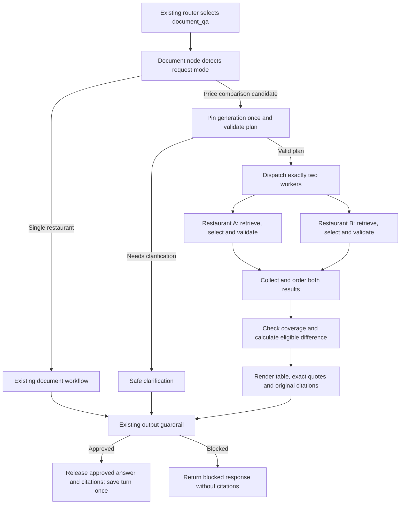

# Handoff PRD: Compare restaurant menu prices using verified documents

**Status:** Owner approved implementation with “Proceed.” Local implementation and offline acceptance checks completed. AWS deployment, live model/ranking validation and Git publication have not been performed for this feature.

**Audience:** The project owner and the engineer or coding agent implementing the next functional improvement for the AI engineering portfolio demonstration.

**Repository:** `C:/Users/kinoc/Documents/Codex/2026-09-28/i-x20/work/agentic-ai-langgraph-and-aws-agentcore`

**Inspected branch / HEAD:** `feat/jev-router` / `f6513da1467d7b269cf5c41e372870bd1aadec22`.

## 1. Outcome and reason for the work

Build a document comparison workflow that answers one bounded question: **what are the listed prices of the same named menu item at two explicitly named fictional catalog restaurants?** Show the original evidence for each restaurant and calculate the difference only when the evidence supports that calculation.

Example request:

> Compare the mushroom pasta prices at Harbor Pasta Lab and Sakura Table Lab. Show the sources.

The existing v2 sample documents list RM32 per serving at Harbor and RM36 per serving at Sakura. The intended response contains both verified menu records, two clickable original-document references and an application-calculated RM4 difference per serving. This is an example based on inspected local fixtures; it does not assert which corpus generation is currently active in AWS.

This feature adds an engineering capability beyond answering one document question: bounded task decomposition, parallel retrieval with isolated scope, evidence validation, deterministic calculation, and honest partial results. The target is a controlled portfolio demonstration. A performance benchmark, recorded walkthrough and LinkedIn publication are outside this phase.

### Deliverables after implementation approval

1. A working comparison subgraph inside the existing document-answering path.
2. Strict request, evidence and calculation contracts with explicit failure behavior.
3. Complete or partial comparison responses using the existing source viewer.
4. Offline tests and a separate comparison evaluation dataset exercising the real implementation with simulated providers.
5. Updated local documentation and an execution record mapping evidence to the acceptance criteria below.

## 2. What exists and should be reused

The following facts were established by reading the worktree, rather than by running a new AWS validation:

| Existing component | Relevant behavior | Consequence for this feature |
| --- | --- | --- |
| [Document resolver](C:/Users/kinoc/Documents/Codex/2026-09-28/i-x20/work/agentic-ai-langgraph-and-aws-agentcore/restaurant-finder-api/src/application/document_rag/retrieval.py) | Resolves one registered restaurant; multiple restaurants currently produce a clarification. Pins the active generation and validates retrieved scope, metadata and chunk content. | Introduce a separate bounded comparison planner; retain the existing resolver for other questions. |
| [Document workflow and renderer](C:/Users/kinoc/Documents/Codex/2026-09-28/i-x20/work/agentic-ai-langgraph-and-aws-agentcore/restaurant-finder-api/src/application/document_rag/workflow.py) | Runs retrieval and quote selection, verifies exact quotations and pinned provenance, and builds citation metadata from originals. | Reuse the selector prompt, evidence checks and citation renderer. Avoid a second free-form answer model. |
| [RAG contracts](C:/Users/kinoc/Documents/Codex/2026-09-28/i-x20/work/agentic-ai-langgraph-and-aws-agentcore/restaurant-finder-api/src/domain/document_rag.py) | Quotes are bounded to 600 characters; citations are strict and limited to three; citations currently require `answered`. | Add a tightly constrained `partial` outcome; comparison itself uses at most two citations. |
| [Orchestrator nodes](C:/Users/kinoc/Documents/Codex/2026-09-28/i-x20/work/agentic-ai-langgraph-and-aws-agentcore/restaurant-finder-api/src/application/orchestrator/workflow/nodes.py) | Jev routes first with Bedrock fallback. A complete answer is checked by the output guardrail before citations and approved memory are released. | Keep this approval boundary. Extend citation release to validated partial comparisons. |
| [Orchestrator state](C:/Users/kinoc/Documents/Codex/2026-09-28/i-x20/work/agentic-ai-langgraph-and-aws-agentcore/restaurant-finder-api/src/application/orchestrator/workflow/state.py) | Persists a single approved document restaurant scope. | A two-restaurant response must not leave an arbitrary single restaurant as the follow-up scope. |
| [Turn streaming](C:/Users/kinoc/Documents/Codex/2026-09-28/i-x20/work/agentic-ai-langgraph-and-aws-agentcore/restaurant-finder-api/src/application/orchestrator/streaming.py) | Resets transient RAG fields for each turn and returns approved text/citations. | Reset a new transient mode field and retain the existing complete-response transport. |
| [Original-document viewer](C:/Users/kinoc/Documents/Codex/2026-09-28/i-x20/work/agentic-ai-langgraph-and-aws-agentcore/restaurant-finder-ui/source_documents.py) | Accepts up to three strict citations from one generation, verifies original hashes, and supports PDF pages or Markdown sections/lines. | Two citations from one pinned generation fit the current transport and viewer. Confirm compatibility with tests. |
| [Existing RAG evaluator](C:/Users/kinoc/Documents/Codex/2026-09-28/i-x20/work/agentic-ai-langgraph-and-aws-agentcore/restaurant-finder-api/src/evaluation/rag.py) | Measures single-restaurant workflow behavior using a versioned 17-case dataset and separate expected/simulated inputs. | Keep those contracts and cases. Add a separate comparison evaluator rather than weakening existing scoring. |

The controlled catalog contains Harbor Pasta Lab, Sakura Table Lab and Spice Garden Lab. Harbor's menu original is a PDF; Sakura's and Spice's menus are Markdown. The corpus already contains the ingredients for a supported Harbor/Sakura comparison and a missing-item comparison involving Spice. No corpus publication or infrastructure provisioning is needed for local implementation.

The previous Runtime warning investigation is separate work. Preserve its untracked [handoff record](C:/Users/kinoc/Documents/Codex/2026-09-28/i-x20/work/agentic-ai-langgraph-and-aws-agentcore/docs/HANDOFF_PRD_RUNTIME_WARNINGS.md). Do not treat the historical rollout and CI results in that record as fresh verification of this feature.

## 3. Scope and chosen first-version limits

### Included

- Exactly two distinct restaurants explicitly identified through registered names or aliases in the pinned manifest.
- One named menu item, one criterion: `menu_item_price`.
- Bounded deterministic parsing for the request forms in section 4.
- Two parallel, independent restaurant retrieval/selection workers.
- One active-generation pin shared by both workers.
- Exact, relevant menu-record quotations and immutable original-document citations.
- Server-derived monetary facts using `Decimal`; same-currency/same-unit comparisons and ties.
- Clear missing, unsupported-format, conflicting-evidence and operational-error behavior.
- Existing Jev/Bedrock routing, output guardrails, response transport and approved memory behavior.
- Offline functional evaluation and regression checks; safe comparison tracing.

### Deferred

- Three or more restaurants, multiple dishes or criteria in one request.
- General cancellation-policy, dietary-suitability or ingredient comparisons.
- Inferring comparable serving sizes, currency conversion, discounts, tax or service charges.
- Unrestricted natural-language planning or an LLM deciding which restaurants/criteria to compare.
- Remembering a restaurant pair for pronoun-based follow-ups.
- Combining real web results with the fictional document corpus.
- Document uploads, new documents, schema migrations, new AWS resources or dependency upgrades.
- AWS rollout, new live calls, Git publication, video recording and LinkedIn posting.

These are the approved first-version limits. Broader comparison criteria can be added through a later reviewed scope.

## 4. Request admission and plan construction

### 4.1 Accepted forms

Support these complete request forms, including case differences, normal whitespace, optional final punctuation, registered short aliases, an optional leading `the` before the item, and an optional final `show the sources` sentence:

1. `Compare <item> price(s) at <restaurant A> and <restaurant B>`.
2. `What is the price difference for <item> between <restaurant A> and <restaurant B>?`.
3. `Which is cheaper for <item>: <restaurant A> or <restaurant B>?`.

Do not hardcode mushroom pasta as the only possible item. Accept a bounded literal item name and validate its identity against retrieved menu evidence later. The third form still answers a listed-price question, not a claim that one restaurant is generally better or cheaper.

### 4.2 Parsing rules

1. Detect a comparison candidate using explicit comparison and price/cheaper cues. Candidate detection is a guard against silently falling into the single-restaurant path when a price comparison is malformed.
2. Reject questions longer than 1,000 canonical characters rather than truncating them into a valid-looking comparison. Normalize NFC, whitespace, case for matching and harmless terminal punctuation. Preserve the original question separately.
3. Full-match one supported form. Restaurant operands must each resolve completely to one registered name/alias; use escaped, bounded matches and prefer the longest alias where aliases overlap.
4. Preserve the request's left-to-right restaurant order. Reject duplicate restaurant IDs, an unknown operand, a third restaurant, extra constraints or an unconsumed suffix. Never keep the first two and discard the rest.
5. Bound the item name to 1-80 characters, using letters/numbers, spaces, apostrophes and hyphens. Reject control characters, conjunctions joining dishes, and reserved extra-criterion terms such as cancellation, parking, policy or allergies. Document the accepted grammar in tests.
6. Set criterion to `menu_item_price` in server code. Set each retrieval filter to the corresponding restaurant ID and `document_type="menu"`; the model cannot supply these fields.
7. Validate the parsed IDs against the pinned manifest before any embedding, vector query or quote-selector call.
8. A malformed candidate returns a concrete clarification with an accepted example. Do not invoke a planner model, a rewrite model or repair loop.

Non-price comparisons such as `Compare Harbor and Sakura menus` retain the existing multiple-restaurant clarification. Existing single-restaurant questions continue through the existing resolver. Comparison does not infer names or dishes from prior responses.

The parent Jev/Bedrock router remains unchanged in this phase. Its document-priority behavior is reused. Offline integration tests can demonstrate behavior with prescribed router outputs; they cannot establish current Jev classification accuracy. Live routing of the three request forms remains a later deployment-validation requirement.

## 5. Workflow design

Keep the public `document_qa` node. Dispatch inside that node to the existing single-restaurant implementation or the new private comparison subgraph. Preserve the current orchestration graph's output-guardrail and memory edges.



### 5.1 Coordinator and private state

- Compile a separate `StateGraph` using `Send` to dispatch exactly two worker inputs and a reducer to collect results. Each input contains a validated restaurant ID, the same literal item, the fixed criterion, the pinned manifest/generation, and the common deadline.
- Compile the comparison graph with `checkpointer=False`. It is per-request work with no pause/resume requirement. The parent keeps its existing conversation memory; retrieved passages and private worker state must not be added to the parent checkpoint.
- The manifest is read once and treated as immutable. Workers receive independent validated copies or immutable views; they do not re-read `active.json` or call `pin()`.
- Inject dependency factories and a clock at the workflow boundary for offline execution. Avoid module-global mutable adapters, counters or a shared selector instance.
- Collect exactly one result per planned restaurant. Reject missing, duplicate or unplanned worker results. Sort by plan order, irrespective of completion order. Aggregate/render exactly once after both workers settle.
- Return only the final safe result to the parent. Preserve `additional_kwargs={"document_rag_response": True}` on its assistant message so existing router history filtering remains effective.

LangGraph documents worker-specific inputs with `Send` and shared reduced outputs. It also documents stateless subgraphs and wrapper-based state mapping. The selected design uses those mechanisms with a fixed server-built plan. [LangGraph workflows](https://docs.langchain.com/oss/python/langgraph/workflows-agents), [LangGraph subgraphs](https://docs.langchain.com/oss/python/langgraph/use-subgraphs).

### 5.2 Worker sequence

For each of the two restaurants:

1. Construct an independent retriever with `top_k=min(settings.RAG_TOP_K, 5)` and the existing context-character ceiling.
2. Build a standalone retrieval/selection question from the validated item and restaurant name. Ask for one complete menu record, retaining currency, unit and any adjacent qualifiers. Do not rewrite using previous conversation content.
3. Retrieve against the shared pinned generation and explicit restaurant/menu filter.
4. If no verified passages exist, return `missing` without a selector call.
5. Otherwise call the existing `RAG_ANSWER_PROMPT`/`RagAnswerDraft` structured selector once, at temperature zero and at most 1,600 output tokens.
6. An `answered` draft must contain exactly one selection for this branch. An `insufficient_evidence` draft must contain none. Extra or malformed selections are invalid; do not silently slice them.
7. Check exact quote, relevant item identity, scope, generation and provenance before accepting evidence or deriving a price fact.
8. Return a typed result with verified evidence or a fixed reason code. Do not return free-form model prose or an assistant/tool message.

Use isolated SDK clients and embedding counters. Construct each thread's session/clients within its synchronous work, or construct independent clients sequentially before dispatch and pass only clients across threads. Do not concurrently create clients through the shared default Boto3 session or share a `Session` across worker threads. Boto3 explicitly documents that sessions are not thread safe. [Boto3 session guidance](https://docs.aws.amazon.com/boto3/latest/guide/session.html).

## 6. Contracts, quote checks and deterministic calculation

### 6.1 New internal contracts

Use strict Pydantic contracts with unknown fields forbidden and bounded collections/strings:

| Contract | Required meaning |
| --- | --- |
| `ComparisonPlan` | Exactly two unique catalog IDs in request order; one item; criterion `menu_item_price`; pinned generation. |
| `ComparisonRow` | One planned restaurant; evidence status `supported`, `missing`, `unavailable` or `invalid`; fixed reason code; optional verified selection/evidence; optional server-derived price fact. State/optional fields must agree. |
| `PriceFact` | A finite nonnegative `Decimal` amount, normalized currency and explicit serving unit derived from the verified record. It is never model-authored JSON. |
| `ComparisonResult` | Exactly two ordered rows, generation, evidence coverage, calculation eligibility/result, final text and up to two original citations. Cross-field consistency must be validated. |

Keep provider-attempt observations separate from factual result fields. Do not accept an arbitrary source URL, S3 key, winner, computed difference or model-provided number as a trusted fact.

### 6.2 Evidence and item relevance

Apply existing chunk/provenance checks, then comparison-specific checks:

1. The selected chunk belongs to this worker's exact restaurant, the pinned generation and the menu document type.
2. The canonical quote is a contiguous substring of that verified chunk. Reject invented IDs, changed quotes and instruction-like passages using the existing validator.
3. The quote contains the requested menu entry's title, matched by normalized literal identity. A tomato-pasta price cannot answer a mushroom-pasta request; generic `pasta` does not mean mushroom pasta.
4. Recognize the controlled menu-entry form: title, separator, listed price/unit and adjacent record qualifiers. Preserve the complete item's dietary/timing/negation text when present. Do not accept a price-only quote or omit an adjacent qualifier to make a condition disappear.
5. Establish record boundaries from the controlled fixture syntax, with tests for the canonical whitespace produced by PDF and Markdown extraction. If the boundary or value syntax is unsupported, do not infer a comparable numeric fact. A demonstrably relevant exact quote may be displayed with `Unsupported price format`; an irrelevant or incomplete selected record is invalid.
6. Scan verified retrieved records for conflicting prices for the requested item. Identical overlapping records may be deduplicated; conflicting records return `invalid` with a fixed `conflicting_evidence` reason. Do not choose the newest-looking or cheapest record within a generation.

Conflict detection covers the retrieved evidence only. It is not a guarantee that no conflicting fact exists elsewhere in the corpus. This phase does not fetch every original or expand retrieval to claim corpus-wide completeness.

### 6.3 Value parsing and calculation

- First-version numeric parsing supports fixed listed amounts explicitly labeled `RM` or `MYR`, normalized to `MYR`, with at most two decimal places and an explicit `per serving`, `per bowl` or `per piece` unit. Use bounded digit length and `Decimal` throughout.
- Parse from the validated menu record, anchored to the requested item. Never search for the first number anywhere in a paragraph or reuse an unrelated cancellation fee.
- Reject ranges, `from` prices, discounts, promotional alternatives, multiple amounts, negative/nonfinite values, missing currency or missing units for arithmetic. Other currencies are unsupported for arithmetic in this version.
- Both rows must have supported evidence and comparable price facts with identical normalized currency and unit. Compute the absolute difference in application code. A zero difference is a tie.
- The summary must say it compares **listed document prices per the stated unit**. Do not infer restaurant quality, current availability, serving-size equivalence, tax-inclusive totals or medical suitability.
- Different units, unsupported formats or missing evidence produce no price difference and no cheaper-restaurant claim. Explain the reason using a fixed template.

## 7. Rendering, coverage and failure behavior

### 7.1 Approved-response shape

Render a small deterministic table followed by exact quote blocks and existing source lines. Use catalog names and escaped text, not model-authored labels.

Illustrative v2 result, before the UI replaces source labels with document links:

| Restaurant | Listed mushroom pasta price | Evidence |
| --- | --- | --- |
| Harbor Pasta Lab | RM32 per serving | Source 1 |
| Sakura Table Lab | RM36 per serving | Source 2 |

Then show `Document evidence: 2 of 2 restaurants supported.` and `Harbor's listed price is RM4 lower per serving.` followed by the full validated menu-record quotes and their provenance. The final quote blocks must retain qualifiers such as Sakura's dinner-only availability.

For one missing row, show `Not found in retrieved menu evidence`, identify the supported row and state that the difference cannot be calculated. Absence from retrieval does not prove that the restaurant does not sell that dish.

Call the existing `render_document_answer` once with the ordered accepted selections and aggregate verified evidence from the pinned manifest. Reuse the resulting quote blocks/citation metadata under the table. Do not concatenate two independently rendered answers that both contain `Source 1`.

Source labels must be globally unique, numbered in accepted-row order, with exactly one `Source: Source N — ...` line per citation. Keep the current strict citation fields and SSE payload unchanged. Comparison uses at most two citations; the existing three-citation upper bound for other document answers stays intact.

The current viewer verifies original hashes and opens the referenced PDF page or Markdown location. If viewing an original fails, retain the approved answer and show the existing viewer-unavailable behavior; do not re-run the agent to recover a viewer error.

### 7.2 Outcome policy

Evidence coverage and arithmetic eligibility are separate. Two verified relevant quotes can provide complete evidence while their units or price syntax prevent a calculation.

| Situation | `RagOutcome.status` | Citations | Response rule |
| --- | --- | --- | --- |
| Two supported records with comparable price facts | `answered` | Two | Table, exact quotes, deterministic difference or tie. |
| Two supported records; unsupported price format or different units | `answered` | Two | Show evidence; explain that arithmetic is unavailable. No winner. |
| One supported record; other genuinely missing | `partial` | One | Name the missing evidence; no difference/winner. |
| One supported record; other operationally unavailable/timed out | `partial` | One | Name the unavailable branch; do not label it as missing document content. |
| Both genuinely missing | `insufficient_evidence` | None | Insufficient retrieved evidence; no invented facts. |
| No supported record and at least one operational failure | `unavailable` | None | Comparison could not be completed; do not assert document absence. |
| Any forged, out-of-scope, inconsistent-provenance, contradictory or invalid selected record | `invalid_answer` | None | Reject the whole comparison using a safe template. |
| Candidate needs clarification | `clarify` | None | Explain the accepted two-restaurant/one-item scope. |
| Document feature disabled | `disabled` | None | Existing disabled response. |

Differentiate evidence-integrity failures from provider availability failures through typed exceptions or explicit boundary classification. Do not convert every `ValueError` into a harmless partial answer. Catch failures at the smallest useful boundary; cancellation propagates. Log only error types/fixed reason codes.

Extend `RagOutcome` to permit citations for `answered` and `partial` only. The comparison contract enforces exactly one supported row/citation for `partial`. The single-restaurant implementation never produces `partial`. All citations must still match the answer's generation.

For comparison outcomes, set `restaurant_id=None` and `rag_pending_scope=None`; carry the two scoped IDs only in private comparison state. Set `retrieval_count` to the number of branch retrievals actually started, from zero to two, rather than assuming that a valid plan always completed two queries. Preserve the pinned generation on the final outcome where available. A timeout at the outer document-node deadline returns the existing safe unavailable response with no citations; it cannot publish an unfinished partial result.

### 7.3 Guardrail, state and memory behavior

1. Add transient `rag_mode: Literal["single", "comparison"] | None` to orchestrator state and reset it with the other per-turn fields. Do not persist worker passages/results in parent state.
2. Keep the output guardrail's existing complete-answer check. Release citations only for an approved, unchanged document answer with `answered` or validated `partial` status. Blocked or altered/anonymized text receives no original citation attachments.
3. An approved comparison-mode turn clears `rag_approved_scope` to `None`, including an approved comparison clarification. It never sets scope to the left, right or last-finishing restaurant. A blocked turn does not advance/clear approved scope.
4. Preserve `last_approved_intent` updates and existing single-restaurant scope advancement. An explicit later single-restaurant document request re-establishes that single scope normally.
5. After a comparison, `What about its cancellation policy?` must ask which restaurant. Pair-pronoun follow-ups are not implemented in this version.
6. Save the current human message and final approved assistant response once through the existing memory hook. Never save unapproved branch messages or duplicate a turn for two workers.

## 8. Resource limits and deadlines

These are per-comparison application limits, excluding the existing parent router, input/output guardrails and approved memory operations. They are bounds, not measured costs or latency improvements.

| Resource | Maximum |
| --- | --- |
| Active pointer / generation pin | One; at most two pin-related S3 JSON reads and one index validation. |
| Workers | Exactly two for a valid plan; at most two active concurrently. |
| Embedding / vector-query operations | One embedding and one initial vector query per worker; two each total. |
| Vector pagination | One page per comparison query; a next token produces a bounded unavailable result without fetching another page. |
| Retrieved chunks / S3 chunk reads | Up to five per worker, ten total; one SDK attempt per operation. |
| Supplied passage text | At most the configured 9,000 characters per worker; at most 18,000 total. Keep whole passages. |
| Query rewrite / planner calls | Zero. |
| Quote-selector invocations | At most one per worker, two total; no invocation when that worker has no evidence. |
| Selector output | At most 1,600 tokens per worker. |
| Accepted quotes / citations | One per supported worker; at most two total; each quote at most 600 characters. |
| Entire document operation | Existing configured request timeout, at most 60 seconds, including pinning. |
| Worker elapsed deadline | At most 45 seconds, ending at least two seconds before the overall deadline for aggregation. |
| Repair loops / graph retries | Zero. |

Implementation requirements:

- Add an optional query-page ceiling to `VectorStore.query`. Preserve its existing default pagination behavior for all existing callers; comparison passes a ceiling of one.
- Add an optional monotonic deadline to retrieval/pinning. Check it before each external operation and each chunk read. Defaults preserve the single-restaurant path. Share the deadline value, not mutable attempt counters.
- Set the worker deadline to `min(now + 45, overall_deadline - 2)`. If pinning leaves two seconds or less, return unavailable without dispatching workers. The two-second reserve is an application scheduling allowance, not a guarantee that the provider or event loop finishes on time; the outer timeout remains authoritative.
- Retrieval SDK configuration already uses connect timeout 3 seconds, read timeout 10 seconds and `total_max_attempts=1`. Retain these settings.
- Give comparison selectors a construction-time Botocore `Config(connect_timeout=3, read_timeout=20, retries={"total_max_attempts": 1})`. Add an optional model-factory/structured-chain argument and forward it when constructing `ChatBedrockConverse`. Preserve every other caller's defaults.
- Do not apply `.model_copy(update={"config": ...})` to an already-created model and assume its constructed client changed. Inspected installed `ChatBedrockConverse` forwards configuration during client construction. Prove the optional configuration reaches the client with an offline factory test.
- Do not attach LangChain retry wrappers, structured-output repair loops, subgraph retry policies or a third summarizer.
- A worker timeout settles that row as unavailable. Stop starting new operations after its deadline; disregard late results. Cancelling `asyncio.to_thread` does not forcibly stop an in-flight SDK operation. Account for that with bounded SDK timeouts and checks between operations; do not claim that background threads are instantly killed.
- Global timeout or user cancellation must not start another graph attempt. Cancellation must not release citations or save an unfinished response.

Botocore defines `total_max_attempts` as including the initial request; setting it to one disables SDK request retries. [Botocore configuration reference](https://docs.aws.amazon.com/botocore/latest/reference/config.html).

## 9. Planned file changes

All entries below are implementation work after approval. New-file paths are proposals; they did not exist when this PRD was prepared.

| File | Responsibility |
| --- | --- |
| New `C:/Users/kinoc/Documents/Codex/2026-09-28/i-x20/work/agentic-ai-langgraph-and-aws-agentcore/restaurant-finder-api/src/domain/document_comparison.py` | Strict plan, row, price and comparison-result contracts; fixed reason/status enums. |
| New `C:/Users/kinoc/Documents/Codex/2026-09-28/i-x20/work/agentic-ai-langgraph-and-aws-agentcore/restaurant-finder-api/src/application/document_rag/comparison.py` | Pure request parsing, item/record validation, value parsing, coverage decisions and deterministic table calculation/rendering. |
| New `C:/Users/kinoc/Documents/Codex/2026-09-28/i-x20/work/agentic-ai-langgraph-and-aws-agentcore/restaurant-finder-api/src/application/document_rag/comparison_workflow.py` | Private LangGraph, two scoped workers, dependency injection, deadlines and aggregation. |
| [Document workflow](C:/Users/kinoc/Documents/Codex/2026-09-28/i-x20/work/agentic-ai-langgraph-and-aws-agentcore/restaurant-finder-api/src/application/document_rag/workflow.py) | Dispatch comparison mode; accept optional selector client configuration; reuse citation rendering. Preserve the single-answer entry point used by existing tests. |
| [RAG contracts](C:/Users/kinoc/Documents/Codex/2026-09-28/i-x20/work/agentic-ai-langgraph-and-aws-agentcore/restaurant-finder-api/src/domain/document_rag.py) | Permit the constrained partial citation outcome without weakening provenance validation. |
| [Retriever](C:/Users/kinoc/Documents/Codex/2026-09-28/i-x20/work/agentic-ai-langgraph-and-aws-agentcore/restaurant-finder-api/src/application/document_rag/retrieval.py) | Optional deadline/page-ceiling forwarding; typed integrity errors where needed; default behavior preserved. |
| [Vector adapter](C:/Users/kinoc/Documents/Codex/2026-09-28/i-x20/work/agentic-ai-langgraph-and-aws-agentcore/restaurant-finder-api/src/infrastructure/vector_store.py) | Optional comparison pagination ceiling. |
| [Model factory](C:/Users/kinoc/Documents/Codex/2026-09-28/i-x20/work/agentic-ai-langgraph-and-aws-agentcore/restaurant-finder-api/src/infrastructure/model.py) | Optional construction-time client configuration; unchanged default call behavior. |
| [Parent nodes](C:/Users/kinoc/Documents/Codex/2026-09-28/i-x20/work/agentic-ai-langgraph-and-aws-agentcore/restaurant-finder-api/src/application/orchestrator/workflow/nodes.py) | Partial citation approval and approved comparison scope clearing. |
| [Parent state](C:/Users/kinoc/Documents/Codex/2026-09-28/i-x20/work/agentic-ai-langgraph-and-aws-agentcore/restaurant-finder-api/src/application/orchestrator/workflow/state.py), [turn streaming](C:/Users/kinoc/Documents/Codex/2026-09-28/i-x20/work/agentic-ai-langgraph-and-aws-agentcore/restaurant-finder-api/src/application/orchestrator/streaming.py) | Mode field/reset, with transport and approved-response behavior retained. |
| New `C:/Users/kinoc/Documents/Codex/2026-09-28/i-x20/work/agentic-ai-langgraph-and-aws-agentcore/restaurant-finder-api/tests/test_document_comparison.py` | Parser, contracts, price math, private graph, concurrency, limits and failure tests. |
| [Existing citation tests](C:/Users/kinoc/Documents/Codex/2026-09-28/i-x20/work/agentic-ai-langgraph-and-aws-agentcore/restaurant-finder-api/tests/test_document_citations.py), [retrieval tests](C:/Users/kinoc/Documents/Codex/2026-09-28/i-x20/work/agentic-ai-langgraph-and-aws-agentcore/restaurant-finder-api/tests/test_document_rag_retrieval.py), [router tests](C:/Users/kinoc/Documents/Codex/2026-09-28/i-x20/work/agentic-ai-langgraph-and-aws-agentcore/restaurant-finder-api/tests/test_router.py) | Relevant regressions for source approval, scope/reset and existing routing contracts. |
| [UI source tests](C:/Users/kinoc/Documents/Codex/2026-09-28/i-x20/work/agentic-ai-langgraph-and-aws-agentcore/restaurant-finder-ui/tests/test_source_documents.py), [SSE tests](C:/Users/kinoc/Documents/Codex/2026-09-28/i-x20/work/agentic-ai-langgraph-and-aws-agentcore/restaurant-finder-ui/tests/test_sse_responses.py) | Two-original comparison response, one-source partial response and failure compatibility. Production UI changes only if a demonstrated incompatibility requires them. |
| New `C:/Users/kinoc/Documents/Codex/2026-09-28/i-x20/work/agentic-ai-langgraph-and-aws-agentcore/restaurant-finder-api/src/evaluation/document_comparison.py` | Strict offline comparison harness, independent scoring and safe reports. |
| New `C:/Users/kinoc/Documents/Codex/2026-09-28/i-x20/work/agentic-ai-langgraph-and-aws-agentcore/restaurant-finder-api/src/evaluation/datasets/document_comparison.json` | Curated expected results and separate simulated worker inputs. |
| [.github/workflows/ci.yml](C:/Users/kinoc/Documents/Codex/2026-09-28/i-x20/work/agentic-ai-langgraph-and-aws-agentcore/.github/workflows/ci.yml) | Add offline comparison evaluation/summary artifacts using existing pinned actions and credential-free jobs. |
| [Document RAG guide](C:/Users/kinoc/Documents/Codex/2026-09-28/i-x20/work/agentic-ai-langgraph-and-aws-agentcore/docs/DOCUMENT_RAG.md), [CI/evaluation guide](C:/Users/kinoc/Documents/Codex/2026-09-28/i-x20/work/agentic-ai-langgraph-and-aws-agentcore/docs/CI_AND_RAG_EVALUATION.md), this PRD | Explain accepted requests, limitations, verification commands and actual completion evidence. |

Do not change corpus originals, prompt versions/manifests, CDK resources, environment secrets or lockfiles to make this feature pass. The existing selector prompt already requests verbatim menu records with qualifiers; the new worker supplies a bounded standalone question. This plan needs no new prompt-management synchronization.

## 10. Observable definition of done

Local implementation is complete only when every acceptance criterion below has supporting evidence or an explicitly reported unmet result. Live behavior remains a separate validation gap until a rollout is approved.

| ID | Acceptance criterion | Required local evidence |
| --- | --- | --- |
| AC1 | Accepted request forms produce two unique explicit restaurant scopes, one item and menu-only filters. Malformed requests clarify without downstream embedding/query/selector calls. | Parser/integration tests with measured call counts. |
| AC2 | Harbor/Sakura v1 gives RM28 vs RM36 and RM8 difference; v2 gives RM32 vs RM36 and RM4 difference, using the real fixture records. | Offline observations scored against independent fixture gold. |
| AC3 | Both branches use the one pinned generation even if the simulated active pointer changes between worker executions. | Pin-read count and generation/provenance assertions. |
| AC4 | Unrelated menu records, price-only/incomplete quotes, fabricated chunks, modified quotes and scope/hash/generation mismatches never produce an accepted comparison. | Fault cases with `invalid_answer`, no citations and no numeric conclusion. |
| AC5 | Arithmetic uses `Decimal`; ties are correct; unsupported formats/currencies and different units never produce a difference or winner. | Pure helper tests plus report cases where fixtures permit them. |
| AC6 | Missing and unavailable evidence are distinguished; one supported branch can produce exactly one cited partial response. Integrity failures reject the complete comparison. | Controlled worker outcomes and aggregation assertions. |
| AC7 | Exactly two workers can overlap; completion order cannot change row/citation order. Duplicate/unplanned results are rejected. | Async barrier/event tests, not wall-clock performance claims. |
| AC8 | Attempt, page, context, quote and timeout ceilings are enforced with no implicit retry/repair. No new operation starts after the deadline. | Instrumented fake adapters/client-factory tests and cancellation/deadline assertions. |
| AC9 | Complete/partial answers pass the existing approval boundary; changed/blocked answers lose citations; only approved final turns are saved once. | Parent-node/memory/transport tests with guardrails simulated. |
| AC10 | Approved comparisons clear single-restaurant follow-up scope; blocked turns preserve it; explicit single-restaurant requests restore normal scope. | Consecutive-turn tests, including an ambiguous pronoun follow-up. |
| AC11 | Both PDF and Markdown originals remain inspectable through existing citation metadata; partial/failed viewer behavior is consistent. | UI source/SSE tests with simulated original reads/hash checks. |
| AC12 | Existing single-restaurant regressions and all 17 original offline cases pass without changing their expectations to accommodate the feature. | Current API/UI suite results and original RAG report. |
| AC13 | The separate comparison report covers its complete dataset, fails on omitted/duplicate/unknown cases, and exercises actual planner/workers/validation/rendering. | Full offline report plus evaluator rejection tests. |
| AC14 | New traces/reports contain bounded IDs/status/counters only; no raw question, quote, provider payload, session or credentials. | Captured telemetry/report assertions and final diff review. |

## 11. Offline evaluation design

### 11.1 Harness requirements

- Call the real comparison admission, planner, compiled subgraph, `DocumentRetriever`, evidence validator, calculator and renderer. Simulate stores, vector hits, embeddings and selectors through injected dependencies.
- Reuse existing offline corpus-building and cloud-client prohibition helpers where suitable. The harness must forbid real Boto3 client/session construction; CI must require no credentials or prompt synchronization.
- Keep `expected` gold and `simulation` inputs separate. Never construct an observation by copying the expected final response/status/difference.
- Gold quotes must be checked against actual local source chunks and locations. Require independent assertions for item relevance, row order, same generation, exact citations, numeric conclusions, coverage and measured call counts.
- Use existing fictional fixtures for normal corpus cases. Numerical edge cases unsupported by those originals belong in clearly labeled pure contract tests or separately constructed in-memory synthetic manifests; do not present them as fixture facts.
- Reports must identify `offline_regression` and `simulated_dependencies`. Live routing, semantic ranking, real selector accuracy, latency and cost are `unmeasured`.
- Bound input files to 2 MiB, at most 50 cases, two rows, two citations, ten evidence records and 15,000 final-response characters per observation. Forbid unknown fields, duplicate IDs and nonfinite JSON numbers.
- Exit 0 only when the full dataset is covered and all required checks pass; exit 1 for failed/incomplete observations; exit 2 for malformed input or execution failure. Do not use stale reports from earlier invocations as success evidence.
- Save summary JSON/Markdown with case IDs, pass/fail/unmeasured checks, safe status/reason codes and counters. Omit raw answer/evidence bodies, full generation contents and provider data from published artifacts.

### 11.2 Initial curated dataset

Provide at least these 20 cases, with stable unique IDs. More cases may be added within the ceiling; the report must account for the actual entire dataset.

| ID | Scenario |
| --- | --- |
| `price_v2` | Harbor/Sakura v2 mushroom pasta, RM4 difference. |
| `price_v1` | Harbor/Sakura v1 mushroom pasta, RM8 difference. |
| `difference_form` | The supported price-difference question form. |
| `cheaper_form` | The supported cheaper-for-item question form. |
| `short_aliases` | Registered short aliases resolve exactly. |
| `reverse_order` | Sakura named first; citations follow request order. |
| `case_whitespace` | Case/whitespace/punctuation normalization. |
| `missing_right` | Harbor/Spice mushroom pasta; Spice has no selected supporting record. |
| `missing_left` | Spice/Harbor mushroom pasta; supported source still receives Source 1. |
| `missing_both` | A named item absent from both retrieved menus. |
| `unknown_operand` | One explicitly unknown restaurant; clarification, no retrieval. |
| `duplicate_operand` | Two aliases of the same restaurant; clarification. |
| `third_restaurant` | Three restaurants; no silent two-restaurant truncation. |
| `extra_criterion` | Price plus cancellation policy; clarification. |
| `two_items` | Conjoined dish names; clarification. |
| `wrong_item_quote` | A valid quote for another dish; invalid answer. |
| `forged_chunk` | Selector references an unknown chunk; invalid answer. |
| `modified_quote` | Changed price text; invalid answer. |
| `worker_unavailable` | One provider error and one supported branch; cited partial result. |
| `pointer_changes` | Active-pointer change after pinning; both branches retain the pinned generation. |

Add unit/integration coverage beyond the dataset for unsupported currencies, ranges, different units, ties, contradictory retrieved records, missing qualifiers, malicious passages, deadline exhaustion, pagination refusal, duplicate aggregation results, concurrency, guardrail changes, memory and source-viewer failures.

## 12. Execution steps after owner approval

### Step 1 — Establish the local baseline and implementation boundaries

1. Read this PRD and supplied/applicable AGENTS instructions. Inspect branch, HEAD and `git status` again; do not assume the preparation baseline is unchanged.
2. Preserve unrelated changes and the existing Runtime warning handoff. Do not reset the checkout, alter AWS settings or create a new user-owned chat.
3. Confirm locked dependencies already provide `StateGraph`, `Send`, strict Pydantic contracts and configurable Bedrock clients. Read installed interfaces rather than upgrading packages.
4. Record accepted scope, acceptance IDs and planned offline commands in the execution record section below.

**Step complete when:** the baseline/diff boundaries and offline-only verification environment are recorded.

### Step 2 — Implement contracts and deterministic admission

1. Add strict comparison contracts and fixed reason codes.
2. Implement candidate detection and full supported-form parsing against an injected catalog.
3. Add parser tests for accepted aliases/order/normalization and every rejection in section 4, including oversized input.
4. Keep the existing single-restaurant resolver and its multiple-restaurant clarification behavior unchanged for unsupported non-price questions.

**Step complete when:** valid plans are bounded and malformed candidates cannot reach retrieval.

### Step 3 — Implement evidence-to-fact validation and rendering

1. Implement literal item identity and complete controlled menu-record validation using real canonical fixture text.
2. Implement fixed-price parsing and `Decimal` comparison; add tests for all unsupported value forms, units and ties.
3. Implement coverage/failure aggregation using the exact policy in section 7.
4. Reuse the existing provenance/citation renderer once per final response; test ordered source labels, escaped table content and qualifier retention.

**Step complete when:** pure tests demonstrate that numeric claims cannot originate from unverified or unrelated text.

### Step 4 — Implement bounded provider boundaries

1. Add optional deadline/page-ceiling controls with defaults preserving existing callers.
2. Add comparison-only construction-time model configuration and verify its forwarding without contacting AWS.
3. Build independent worker adapters with one-attempt embeddings, no shared mutable counters and safe session/client creation.
4. Test page refusal, deadline checks before each operation, bounded context/reads and exception classification.

**Step complete when:** fakes demonstrate the section 8 limits and default single-restaurant compatibility.

### Step 5 — Implement and exercise the private comparison graph

1. Pin once, validate the manifest/plan, then issue exactly two `Send` worker inputs.
2. Execute retrieve → one structured selection → validation for each worker, with deadline-aware unavailable results and propagated cancellation.
3. Aggregate exactly two planned row results, order deterministically and render once.
4. Compile with `checkpointer=False`; test that no worker passages are merged into parent messages/state.
5. Use async barriers/events to prove overlap and reversed completion order without interpreting the test as a speed benchmark.

**Step complete when:** the real compiled subgraph satisfies scope, generation, concurrency and failure contracts under injected dependencies.

### Step 6 — Integrate approval, follow-up scope and UI transport

1. Dispatch from the existing document node; preserve the existing single-answer callable and its tests.
2. Add/reset `rag_mode`; add constrained partial outcomes and citation release.
3. Clear approved single scope after approved comparison-mode turns; test blocked/changed responses and explicit scope restoration.
4. Confirm one approved final response is saved by the existing memory hook and no worker response is independently persisted.
5. Add UI compatibility tests for two originals, a one-source partial result, exact source lines, hash failures and malformed citations. Change production UI only if these reveal a necessary fix.

**Step complete when:** final approval, citations, follow-up scope and memory match AC9-AC11.

### Step 7 — Add the separate evaluator and CI step

1. Implement the bounded dataset/harness/report contracts and the 20 minimum cases.
2. Exercise the actual code with simulated dependencies and independently score all observations.
3. Add malformed/incomplete/duplicate dataset and report-rejection tests.
4. Add the comparison evaluator to the existing offline API CI job and include only safe reports in existing summary/artifact steps. Reuse the pinned actions and permissions; do not dispatch deployment workflows or change action references/secrets.
5. Keep the original 17-case dataset and original scorer semantics intact.

**Step complete when:** the complete new dataset and old dataset can each fail independently and publish an honest safe summary.

### Step 8 — Run approved offline checks and inspect evidence

The commands below are instructions for the implementation phase, not commands executed when preparing this PRD. Use the existing locked environment; no AWS login or model access is required. If the environment is missing dependencies, report that and arrange a locked installation rather than upgrading versions.

Run in `C:/Users/kinoc/Documents/Codex/2026-09-28/i-x20/work/agentic-ai-langgraph-and-aws-agentcore/restaurant-finder-api`:

```powershell
$env:PROMPT_SYNC_MODE='false'
$env:PROMPT_MANIFEST_PATH='.generated/offline-no-manifest.json'
$env:REQUIRE_PROMPT_MANIFEST='false'
$env:AWS_EC2_METADATA_DISABLED='true'
$env:AGENT_OBSERVABILITY_ENABLED='false'
$env:EVALUATION_ENABLED='false'
$env:LOGURU_LEVEL='ERROR'
uv run --no-sync python -m unittest discover -s tests -p test_document_comparison.py -q
uv run --no-sync python -m unittest discover -s tests -q
uv run --no-sync python -m src.evaluation.rag --offline --output .generated/evaluation/document-rag.json
uv run --no-sync python -m src.evaluation.document_comparison --offline --output .generated/evaluation/document-comparison.json
```

Verify the manifest-path target is absent before using it; do not delete a user-created manifest to force offline behavior. Retain/restore process environment settings as appropriate. Inspect every exit code and report, including actual case/test counts, missing cases and unmeasured checks. Test output is evidence only for the current invocation.

Run UI regressions in `C:/Users/kinoc/Documents/Codex/2026-09-28/i-x20/work/agentic-ai-langgraph-and-aws-agentcore/restaurant-finder-ui` with the same offline environment:

```powershell
uv run --no-sync python -m unittest discover -s tests -q
```

Infrastructure code is outside this change. Retain its existing CI job; no local authenticated synth/deploy is needed. Review the YAML diff and exercise the repository's existing workflow-contract assertions through the API suite.

**Step complete when:** current API/UI regression results, original RAG report and complete comparison report are inspected and every unmet check is reported.

### Step 9 — Document the result and stop at the local boundary

1. Update the RAG/evaluation guides with supported request examples, arithmetic limits, partial-result policy and report interpretation.
2. Record actual acceptance evidence and unresolved gaps below. Do not mark live behavior or routing verified from offline doubles.
3. Review the complete diff for unrelated edits, secrets, raw data artifacts, source-schema changes and accidental cloud/prompt actions. Remove only task-created temporary files; preserve user-created files.
4. Present the local feature and verification results for review. Stop before Git push, AWS build/rollout, new model calls or a recorded walkthrough.
5. If deployment is desired, prepare a separate concrete rollout scope, including immutable image identity, rollback plan, fresh readiness/auth checks and a new explicit live-call allowance. The earlier six-call Runtime allowance is exhausted and is not renewed by this PRD.

**Step complete when:** a reviewable local implementation and honest execution record exist, with the cloud-validation gap explicitly stated.

## 13. Observability and evidence hygiene

Add comparison spans around planning, each scoped worker, validation and aggregation. Reuse the sanitizing RAG span helper.

Allowed attributes: fixed mode/criterion, catalog IDs, generation hash, row status/reason code, branch count, passage/quote/citation counts, context length, attempt counters and duration. Events may identify `partial`, `invalid_answer`, `deadline_exhausted` or a fixed rejection reason.

Never add raw question, quote, retrieved passage, selector output, exception message, provider payload, token/header, actor/session value or source bytes to new logs, spans or evaluation artifacts. Existing parent tracing/history behavior is not expanded by this feature. Test new telemetry with captured fake spans.

## 14. Authorization, tradeoffs and remaining questions

### Authorization boundary

The owner reviewed this PRD and authorized its local implementation/offline checks with “Proceed.” The preparation phase had performed no implementation or feature tests before that approval.

Approval to implement this PRD authorizes the local code/document changes and offline checks described here. It does not authorize AWS deployment, corpus writes, billable live calls, Git push/PR publication, messages to other people or demo recording. Those actions require their own concrete reviewed scope and explicit instruction.

### Tradeoffs to accept with the first version

- A bounded parser asks for clarification on unsupported phrasing. This makes task admission observable without adding a planner call; it is not a universal natural-language interface.
- Exact title matching may reject synonyms such as `fungi pasta`. It prevents silently equating different dishes. Item synonym catalogs are deferred.
- Parallel retrieval increases the maximum document-answering work to two embeddings and two selectors. Latency/cost effects remain unmeasured, and no savings should be advertised.
- A partial result can preserve useful verified evidence after an honest provider failure. Integrity failures reject the entire comparison.
- Stateless workers cannot resume after a process crash. A later user request is a new attempt; the application does not automatically replay provider calls.
- Source provenance and bounded record checks do not prove real model/ranking accuracy or completeness of all corpus facts. Live validation remains separate.

No account/API-key questions were required for local implementation. Cancellation/dietary comparisons and remembered-pair follow-ups remain future scope unless this PRD is revised and approved.

## 15. Execution record — approved local phase completed

| Item | Inspected outcome |
| --- | --- |
| Owner sign-off for implementation | Explicit “Proceed” after the reviewable PRD. |
| Implementation baseline | Branch `feat/jev-router`, HEAD `f6513da1467d7b269cf5c41e372870bd1aadec22`; only this PRD and the prior Runtime warning handoff were untracked. Both were preserved. |
| Baseline verification | 135 API tests and 26 UI tests passed before implementation. |
| Local implementation | Complete: strict contracts, deterministic planner/calculation, stateless two-worker graph, guarded partial responses, scope/reset integration, offline evaluator, CI step and documentation. |
| Final API suite | 166 tests passed, including 30 new comparison/evaluator tests and the additional CI workflow assertion. Final command exited 0. |
| Final UI suite | 28 tests passed. Two new tests cover distinct PDF/Markdown originals and complete/partial clickable source transport. Final command exited 0. |
| Original RAG report | 17/17 cases passed with 374 measured checks; original dataset and scoring semantics unchanged. Command exited 0. |
| Comparison report | 20/20 cases passed with 260 measured checks. Command exited 0. Providers simulated; the compiled graph and application validators/calculator/renderer executed. |
| CI configuration | Comparison evaluation, readable summary and safe report artifacts added using existing pinned actions and read-only permissions. Workflow-contract tests passed locally; no GitHub run was dispatched/published. |
| Diff review | `git diff --check` exited 0. Only comparison-related code/tests/docs and the offline CI workflow changed. Source documents, locks, prompts, environment secrets and infrastructure were not modified. |
| Live Jev routing / Haiku selection / Titan ranking | Unmeasured for comparison. |
| AWS deployment/readiness | Not performed or freshly checked in this phase. |
| Git publication / recording | Not authorized by this PRD. |

### 15.1 Acceptance evidence

The local acceptance matrix is supported by [comparison/API tests](C:/Users/kinoc/Documents/Codex/2026-09-28/i-x20/work/agentic-ai-langgraph-and-aws-agentcore/restaurant-finder-api/tests/test_document_comparison.py), [UI source/transport tests](C:/Users/kinoc/Documents/Codex/2026-09-28/i-x20/work/agentic-ai-langgraph-and-aws-agentcore/restaurant-finder-ui/tests/test_source_documents.py), current full-suite results and the complete evaluator reports:

| Criteria | Local result and evidence |
| --- | --- |
| AC1-AC2 | PASS: supported forms, alias/order normalization and all rejected operands; both real fixture generations and RM8/RM4 calculations independently scored. |
| AC3-AC4 | PASS: one pin despite pointer change; fixed scopes; original generation/location/hash checks; corrupted chunks, changed/forged/wrong-item/incomplete quotations rejected. |
| AC5-AC6 | PASS: Decimal/decimal-format/tie/unit/currency contract checks; exact two-row coverage; missing vs unavailable partials; whole-comparison rejection on conflicts/integrity failures. Synthetic edge inputs are explicitly labeled tests, not edited fixture facts. |
| AC7-AC8 | PASS: async barriers prove worker overlap and reversed completion order; duplicate results rejected; one-page query cap and default compatibility; construction-time model configuration; deadline checks between calls; real branch timer expiration; cancellation during in-flight pin/embedding prevents subsequent reads/queries. |
| AC9-AC10 | PASS: actual parent graph with in-memory checkpointer and simulated routing/guardrail/memory; one approved save; no private worker state in the checkpoint; blocked/masked partial citation handling; cleared scope, ambiguous follow-up clarification and explicit single-scope restoration. |
| AC11-AC12 | PASS: two actual local original files loaded through simulated UI reads; pinned-generation/hash and PDF/Markdown viewer metadata; complete/partial transport; all 166 API and 28 UI regressions and all original 17 RAG cases. |
| AC13-AC14 | PASS: full 20-case independent scorer; missing/duplicate/unknown cases and forged math/evidence/citations cannot pass; safe reports and captured comparison spans omit raw question/quote/provider/session data. |

These PASS results refer to offline contracts and controlled fixtures. They do not close the live validation gap.

### 15.2 Safe local evidence files

- [Final API test log](C:/Users/kinoc/Documents/Codex/2026-09-28/i-x20/work/agentic-ai-langgraph-and-aws-agentcore/restaurant-finder-api/.generated/evaluation/api-tests.log).
- [Final UI test log](C:/Users/kinoc/Documents/Codex/2026-09-28/i-x20/work/agentic-ai-langgraph-and-aws-agentcore/restaurant-finder-ui/.generated/ui-comparison-tests.log).
- [Comparison report JSON](C:/Users/kinoc/Documents/Codex/2026-09-28/i-x20/work/agentic-ai-langgraph-and-aws-agentcore/restaurant-finder-api/.generated/evaluation/document-comparison.json) and [readable report](C:/Users/kinoc/Documents/Codex/2026-09-28/i-x20/work/agentic-ai-langgraph-and-aws-agentcore/restaurant-finder-api/.generated/evaluation/document-comparison.md).
- [Original RAG report JSON](C:/Users/kinoc/Documents/Codex/2026-09-28/i-x20/work/agentic-ai-langgraph-and-aws-agentcore/restaurant-finder-api/.generated/evaluation/document-rag.json) and [readable report](C:/Users/kinoc/Documents/Codex/2026-09-28/i-x20/work/agentic-ai-langgraph-and-aws-agentcore/restaurant-finder-api/.generated/evaluation/document-rag.md).

Reports/logs remain ignored local evidence. No task-created temporary script files remain. The workspace UV cache was used because the default cache was inaccessible; commands selected the existing Python 3.11 environment without synchronization, upgrades or cloud calls.

### 15.3 Repairs and implementation details

- An initial regression exposed that passing a new keyword to the existing single-restaurant node callable broke an older cancellation fixture. The deadline keyword is now passed only in comparison mode, preserving that callable's default invocation; the final cancellation regressions pass.
- Two initial focused failures came from test-fixture setup: a duplicate fake chunk ID overwrote the selected evidence in the renderer, and a comparison-only fake enforced its pagination limit on a later single-restaurant turn. The fixtures now use a distinct synthetic conflict record and the original single-restaurant vector fake respectively. No existing expected RAG result was weakened.
- The sanitizing RAG span helper now preserves safe integrity/timeout exception classes while discarding payloads. This small additional helper change is necessary to distinguish a corrupt source from provider unavailability.
- Cooperative stop events prevent new synchronous SDK operations after cancellation, including during pinning. In-flight operations can finish within their configured timeouts; no claim of forcibly terminating Python threads is made.
- Conflict checks run even if a selector reports insufficient evidence. Equivalent fixed RM/MYR prices normalize before conflict detection.

### 15.4 Remaining work outside the approved local phase

The running/deployed application has not been switched to this code. GitHub CI has not executed the changed workflow. A separately approved publication/rollout phase must establish immutable source/image identity and rollback, then validate actual Jev routing, Haiku selection, vector retrieval, source inspection and memory behavior with a fresh explicit live-call allowance. No benchmark or recorded walkthrough is required by this local phase.
