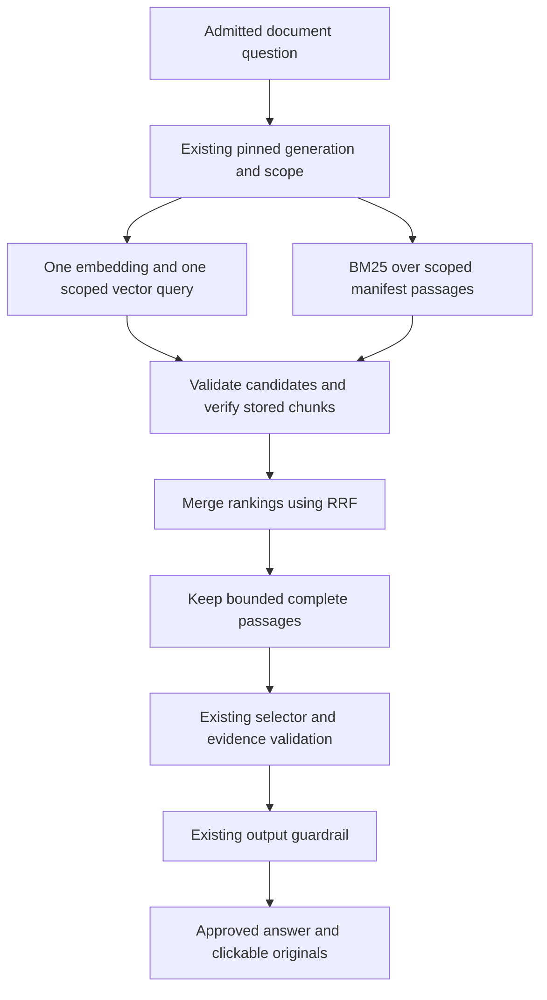

# Handoff PRD for hybrid document retrieval

**Status:** Phase A local implementation, AC01–AC15, offline acceptance, documentation and owned cleanup COMPLETE on 2026-10-15. Publication and AWS rollout require a separate reviewed scope. Stop before the demo walkthrough.

**Prepared:** 2026-10-15, Asia/Kuala_Lumpur.

**Audience:** The project owner and the engineer implementing the next AI engineering portfolio feature.

**Repository:** `C:/Users/kinoc/Documents/Codex/2026-09-28/i-x20/work/agentic-ai-langgraph-and-aws-agentcore`.

**Inspected branch and HEAD:** `feat/document-multipart-rollout`, `b61b1342041fdbe96fb6d5488104995acc371e1f`.

## 1 Outcome and reason

Add an optional retrieval mode that combines the existing semantic vector search with local keyword ranking using BM25, then merges their rankings using Reciprocal Rank Fusion (RRF). Deliver a reviewable local implementation, focused offline regression evidence and documentation explaining the ranking and its limits.

The owner is preparing an AI engineering portfolio demonstration. This feature should make the retrieval design inspectable: exact words and semantic candidates take separate paths, ranking is deterministic, and every selected passage passes the existing source checks. It does not expand the supported question grammar or change which restaurant a question is allowed to access.

A successful result demonstrates correct hybrid retrieval under controlled inputs. The current small fictional corpus does not establish that retrieval is failing, and adding this feature alone does not establish better live accuracy, lower cost or faster responses. The owner has skipped benchmarking; this phase includes functional regression checks only.

The demo walkthrough remains paused.

## 2 Verified starting point

### 2.1 Existing retrieval

The following findings come from inspected source at the HEAD above. API paths in this document are relative to `restaurant-finder-api`.

- `src/application/document_rag/retrieval.py` pins the active generation, resolves catalog scope, embeds the question, queries S3 Vectors and verifies returned chunks against the manifest.
- `GenerationManifest` already contains each passage's full text, location, document identity and hashes. It validates at most 48 chunks. A separate persistent keyword index is unnecessary for this bounded first version.
- `src/infrastructure/vector_store.py` builds generation, restaurant and optional document-type filters in server code. It returns vector distances and metadata.
- The default `RAG_TOP_K` is 5. API settings currently permit 1–10. Comparison workers cap it at 5; multipart workers reuse their scoped retriever factory.
- `RetrievedEvidence.distance` currently requires a float. A keyword-only candidate has no observed vector distance. The implementation must represent that absence truthfully.
- `workflow.make_retriever` constructs the single-question retriever. `comparison_workflow.make_scoped_retriever` constructs the retrievers used by both comparison and multipart workers.
- The selector receives only chunk IDs and text. Citation rendering resolves originals from the same pinned manifest. Ranking scores currently have no role in factual validation.
- Existing offline vector simulations return scripted or manifest-order candidates. They do not measure Titan semantic ranking.

### 2.2 Existing workflows and acceptance record

The README and accepted [follow-up rollout record](HANDOFF_PRD_FOLLOWUP_PUBLICATION_AND_ROLLOUT.md#12-phase-b-execution-and-acceptance) record Runtime/DEFAULT 17, seven accepted requests, multipart and follow-ups enabled, and immutable guardrail `ih5xpt3qi946:1` on 2026-10-14. This is historical accepted evidence; preparing this PRD did not query AWS.

Existing recorded offline coverage is 17 single-document cases, 20 comparison cases, 40 multipart cases and 24 conversation cases. Historical test counts are not targets for the new implementation; record the actual counts after execution.

The owner-created untracked `docs/HANDOFF_PRD_RUNTIME_WARNINGS.md` is unrelated. Its inspected SHA-256 is `c3f491550280ba5568cea656d1e90378a76547ee5520e462a323469949aebf9f`. Preserve it and exclude it from this feature's changes.

## 3 Scope and authorization

### Phase A after sign-off

1. Add strict API and CDK configuration for vector or hybrid retrieval.
2. Implement pure local BM25 ranking and RRF.
3. Integrate the hybrid branch into the shared retriever and both construction sites.
4. Preserve source verification, moderation, conversation state and citation transport.
5. Add targeted unit/integration tests and a separate 24-case offline retrieval dataset.
6. Extend the existing offline CI job and engineering documentation.
7. Execute credential-free local acceptance using existing locked dependencies; retain reports under ignored `.generated` paths.
8. Finish with the local diff, actual results and any unmet acceptance criteria.

### Preserve

Preserve real `.env` files, dependency and lock files, Docker configuration, AWS credentials and identities, IAM, guardrail content/binding, prompts and immutable prompt manifests, sample originals and corpus catalogs, active generation, vector index, existing question grammar, Jev/Bedrock routing, memory approval rules and the running local UI.

Keep the original four regression datasets byte-identical. Preserve all existing exact-quote, complete-record, qualifier, conflict and source-viewing checks.

### Outside Phase A

Do not publish commits, update a PR, merge, push upstream, build/push images, run Docker recovery, perform AWS reads or writes, run live inference, create embeddings for a new corpus, update prompts, switch the active generation, start a paid reranker, install a search service, add general document uploads, run a benchmark or begin the demo.

Phase B may be proposed only after local acceptance. Its publication, deployment, billable request budget, rollback and cleanup must be concrete and approved separately. Earlier live-call or rollback allowances do not apply.

## 4 Proposed design

### 4.1 Request flow



These are logical branches. Execute them within the existing retrieval operation; adding extra threads or cloud concurrency for local BM25 is unnecessary.

### 4.2 Configuration and compatibility

Add `RAG_RETRIEVAL_MODE: Literal["vector", "hybrid"] = "vector"` to API settings and the example environment file. Accept only those exact strings; reject unknown values, different case, surrounding whitespace, booleans and numbers before constructing providers.

Add a keyword-only `retrieval_mode="vector"` argument to `DocumentRetriever`. Validate it independently so direct construction cannot bypass settings. Do not make existing injected retrievers silently read global settings.

In hybrid mode require integer `top_k` from 1 to 5 and the existing maximum of 9,000 context characters. Reject bool values as integer bounds. Reject a hybrid settings combination with `RAG_TOP_K > 5`; retain the existing 1–10 settings range for vector mode. Retain the current vector branch's ordering, provider options and observable behavior.

Both real construction sites must pass the selected mode. The comparison and multipart workers continue to own isolated clients, share one pinned generation per workflow and run at most two workers concurrently. Follow-ups continue to retrieve fresh evidence through those paths.

Add CDK context/prop `ragRetrievalMode`, accepting omission as `vector` or an exact `vector/hybrid` string. Validate CLI context and programmatic props. Serialize `RAG_RETRIEVAL_MODE` on the Runtime; default to `vector`. A vector-to-hybrid toggle must change only that environment value in otherwise identical synthesized templates. Do not change multipart, follow-up or guardrail defaults.

### 4.3 Local keyword candidates

Use the validated pinned manifest as the bounded keyword corpus. At hybrid entry, revalidate `GenerationManifest.model_validate(manifest.model_dump())`; do not trust a previously constructed instance that could have been mutated in memory.

Filter passages by the approved restaurant ID and optional document type **before** computing keyword statistics. Compute term frequencies, document frequencies and average passage length only within that pool. Venue names and aliases remain scope identifiers; the keyword ranker cannot expand scope.

Use a small standard-library implementation in `src/application/document_rag/ranking.py`. No new package is needed for at most 48 passages. Keep functions pure, with immutable private result records, no provider imports, no filesystem access and no process-wide index/cache.

Tokenizer contract:

- Apply existing `canonical_text`, then `casefold()`.
- Extract Unicode alphanumeric token runs with Python `re.findall(r"[^\W_]+", text)`.
- Apply identical tokenization to question and passage text.
- Count repeated passage terms; use sorted unique question terms so repeating a query term does not increase its contribution.
- Use no stop-word list, stemming, synonyms, fuzzy matching or language detection in this version.
- Empty question tokens or an empty scoped pool produce an empty keyword list. Tokenization is for ranking; it never supplies a price, fee, unit or availability fact.

Use the following declared BM25 variant:

```text
k1 = 1.2
b = 0.75
N = number of passages in the scoped pool
df(t) = number of those passages containing term t
idf(t) = ln(1 + (N - df(t) + 0.5) / (df(t) + 0.5))

score(d, q) = sum over unique terms t in q:
    idf(t) * tf(t,d) * (k1 + 1)
    / (tf(t,d) + k1 * (1 - b + b * len(d) / avg_len))
```

Length means token count. If every scoped passage has zero tokens, return an empty list without division. Include only finite, strictly positive scores. Sort by descending score and ascending chunk ID for ties. Return at most `top_k` candidates.

The parameter and IDF choices follow the documented [Lucene BM25 definitions](https://lucene.apache.org/core/9_12_1/core/org/apache/lucene/search/similarities/BM25Similarity.html). This implementation uses the declared tokenizer and formula; it does not claim bit-for-bit Lucene scoring or full-text engine equivalence.

### 4.4 Vector candidates and source verification

Keep one embedding operation and one vector query in hybrid mode. Retain the same generation/restaurant/type filters. Hybrid retrieval accepts `max_pages=None` or `1`, normalizes omission to 1 and rejects larger values before provider calls. Do not alter the existing vector adapter's general pagination behavior.

Validate every vector hit before fusion: dictionary shape, key membership, scope, exact metadata, unique key, finite numeric non-boolean distance and returned count. Malformed responses fail the retrieval even if a keyword candidate could answer the question.

For hybrid ranking, sort validated vector hits by ascending distance and ascending chunk ID for ties. Keep the legacy provider ordering in vector mode.

Build the union by the canonical pinned key `generation_id:chunk_id`, at most `2 * top_k` unique passages. Read each union member's stored chunk JSON once and validate it against its manifest reference using the current complete equality checks. Never let keyword text bypass stored-chunk verification, substitute an unverified manifest passage into the selector, or silently discard an integrity failure. Cross-channel overlap is normal and is deduplicated; duplicates inside a provider list are invalid.

No new S3 writes, vector writes, active-pointer reads, re-embedding or persistent index are required. Keyword scoring uses the manifest text already loaded. Verifying extra keyword candidates can add chunk reads; the phase does not claim zero extra AWS work.

### 4.5 Fusion and returned evidence

Assign one-based ranks separately to each candidate list. Compute equal-weight RRF using a fixed constant of 60:

```text
rrf(chunk) =
    (1 / (60 + vector_rank) if present in vector list else 0)
  + (1 / (60 + keyword_rank) if present in keyword list else 0)
```

Sort by descending RRF score and ascending chunk ID for ties. Do not add raw BM25 scores to vector distances, treat either value as confidence, or introduce a score threshold for answering.

Take the first `top_k` fused candidates, then apply the existing complete-passage context budget in that order. Skip a passage that would exceed the configured character budget. Do not truncate records or backfill from outside those first `top_k` candidates. The selector receives at most five passages and 9,000 characters in hybrid mode.

Change only the internal evidence distance contract to `float | None = None`:

- Vector and overlapping candidates retain their actual finite distance.
- Keyword-only candidates use `None`.
- RRF/BM25 scores never masquerade as vector distances.
- No ranking field is added to `DocumentCitation`, SSE events, public answers, parent memory or conversation context.
- Test the evidence model with keyword-only and vector candidates, and inspect every distance consumer for an arithmetic/sorting assumption.

Private rank records may contain candidate keys, scores and ranks for tests. An optional per-call diagnostic observer may capture those records for offline scoring; its default is absent, it must not persist them to graph state, and a failed observer must never cause a public answer to bypass validation.

RRF combines separately ranked lists; see [the formula and one-based rank convention](https://www.elastic.co/docs/reference/elasticsearch/rest-apis/reciprocal-rank-fusion). S3 Vectors continues to provide the scoped semantic branch described in [AWS's query documentation](https://docs.aws.amazon.com/AmazonS3/latest/userguide/s3-vectors-query.html). No Elasticsearch or OpenSearch service is introduced.

### 4.6 Example for the owner

This example illustrates the formula; it is not an observed result from the deployed corpus.

| Passage | Vector rank | Keyword rank | RRF score |
| --- | --- | --- | --- |
| A | 1 | absent | 1/61 |
| B | 2 | 1 | 1/62 + 1/61 |
| C | absent | 2 | 1/62 |

The combined order is B, A, C. B receives support from both searches. C can become evidence even though the vector response omitted it, after the same source verification as A and B.

An exact-name fixture such as "Harbor mushroom pasta price" should exercise the keyword path. A paraphrase fixture should exercise vector-only evidence. Neither fixture implies that the live embedding model will return the scripted ranking.

## 5 Bounds and failure behavior

| Boundary | Hybrid contract |
| --- | --- |
| Generation | Existing validated manifest, maximum 48 chunks; one pinned generation per answer workflow |
| Per branch | At most `top_k <= 5` candidates |
| Candidate union and stored-chunk reads | At most `2 * top_k <= 10`; each unique chunk read once per retrieval |
| Final evidence | At most `top_k <= 5` complete passages, at most 9,000 characters |
| Per retrieval | At most one embedding operation and one vector-query page; no reranker, retry loop or fallback request |
| Multipart | Existing maximum four tasks and two active workers; at most 40 candidate chunk reads across four hybrid tasks, excluding pin reads |
| Model selection | Existing selector calls/token limits only; no additional model introduced |
| Mutable state | None shared between workers or requests; no query/evidence cache |
| Network permissions | Existing read permissions only; no new AWS service or IAM grant |

Honor the supplied deadline/clock and cancellation guards before ranking work, before/after embedding and vector operations, during candidate iteration, and before/after each chunk read. An expired task must not start another provider operation. These checks do not establish that an already-running SDK call or worker thread can be forcibly terminated.

Failure rules:

1. Clarification or an unapproved scope fails before retrieval work, as today.
2. A valid scope with no manifest passages returns empty evidence in hybrid mode with no embedding/vector calls.
3. Empty keyword results with valid vector results use vector candidates through RRF.
4. A successful empty vector response with keyword candidates may answer from verified keyword evidence; its distances are absent.
5. Both lists empty return empty evidence and the existing insufficient-evidence outcome.
6. Embedding/vector exceptions, malformed hits, invalid manifests, mismatched source chunks or non-finite ranks fail through existing safe workflow error handling. Do not hide a provider failure as successful keyword fallback.
7. A passage containing instructions remains document data. Existing selection, exact-quote and moderation rules still determine whether it may appear in an answer.
8. Ranking never converts absence from the result list into a claim that a menu item is unavailable.

## 6 Files and integration responsibilities

Paths below are the planned change surface. If implementation reveals a necessary additional path, document why before expanding the diff. Do not edit unrelated code to fit this list.

| Path | Required work |
| --- | --- |
| `restaurant-finder-api/src/application/document_rag/ranking.py` new | Pure tokenizer, scoped BM25, rank records and deterministic RRF |
| `restaurant-finder-api/src/application/document_rag/retrieval.py` | Explicit mode, preserved vector branch, bounded hybrid flow, verification and safe spans |
| `restaurant-finder-api/src/domain/document_rag.py` | Truthful optional distance; keep citation/outcome/source schemas unchanged |
| `restaurant-finder-api/src/config.py`, `restaurant-finder-api/.env.example` | Strict mode default and hybrid top-k validation/example |
| `restaurant-finder-api/src/application/document_rag/workflow.py` | Pass mode at single-question construction |
| `restaurant-finder-api/src/application/document_rag/comparison_workflow.py` | Pass mode at shared scoped construction; multipart reuses it |
| `restaurant-finder-api/tests/test_document_retrieval_ranking.py` new | Pure math/tokenization/tie/bounds cases |
| `restaurant-finder-api/tests/test_document_hybrid_retrieval.py` new | Real retriever and workflow/factory integration with injected dependencies |
| `restaurant-finder-api/tests/test_document_rag_retrieval.py` | Preserve legacy behavior; add focused compatibility checks if needed |
| `restaurant-finder-api/src/evaluation/document_retrieval.py` new | Offline runner, observation contracts, independent scorer and CLI |
| `restaurant-finder-api/src/evaluation/datasets/document_retrieval.json` new | The 24 required scenarios, independent gold and separate provider scripts |
| `restaurant-finder-api/tests/test_document_retrieval_evaluation.py` new | Dataset/scorer/CLI and mutation checks |
| `restaurant-finder-infra/bin/cdk.ts`, `restaurant-finder-infra/lib/stacks/agentcore-stack.ts` | Strict context/prop and one Runtime environment value |
| `restaurant-finder-infra/test/document-rag.test.ts` | Mode defaults/validation and synthesized toggle comparison |
| `.github/workflows/ci.yml` | One additional offline command, readable summary and two allowlisted reports |
| `README.md`, `docs/DOCUMENT_RAG.md`, `docs/CI_AND_RAG_EVALUATION.md` | Explain local hybrid status, scope, algorithm and report interpretation |
| This PRD | Record actual execution, acceptance and any approved design adjustments |

No UI source change is planned. Existing UI regression tests must pass, and an API integration test must prove a keyword-only selected passage still produces the correct original citation payload.

## 7 Observable definition of done

| ID | Required result | Required evidence |
| --- | --- | --- |
| AC01 | Omitted/vector mode preserves existing behavior; hybrid is explicit and rejects invalid configuration. | Settings, direct constructor, factory and CDK tests; original datasets unchanged |
| AC02 | Tokenization and BM25 follow the declared scoped formula and deterministic tie rule. | Hand-calculated small examples and pure tests, including empty/Unicode/repeated-term cases |
| AC03 | RRF uses one-based ranks, constant 60, overlap deduplication and deterministic ordering. | Independent numerical examples; malformed/duplicate candidate tests |
| AC04 | Keyword-only evidence can reach a selector with distance absent and exact provenance. | Executed real retriever and single-question workflow; correct original citation |
| AC05 | Vector-only evidence remains usable when there is no keyword overlap. | Executed retrieval/workflow with independently scripted vector candidates |
| AC06 | Both branches remain inside the pinned generation, restaurant and type. | Wrong-scope injections, type-None case, pointer changes and parallel worker fixtures |
| AC07 | Every candidate union member passes stored-chunk verification; corrupted hits/chunks cannot be masked by the other branch. | Executed negative cases, including a corrupted candidate outside final top-k |
| AC08 | Candidate, read, character, page, attempt and deadline bounds hold. | Observed fake-provider/read counters and controlled-clock tests |
| AC09 | Single, comparison, multipart and supported follow-ups use the configured mode with unchanged approval/context/source rules. | Factory wiring plus executed integration cases in both modes |
| AC10 | Keyword-only answers preserve complete records, qualifiers, arithmetic and source identity. | Existing validators and independent gold; UI suite remains passing |
| AC11 | All 24 new cases produce complete, independently scored observations; scorer mutations fail. | Fresh JSON/Markdown reports, no missing/unmeasured required checks |
| AC12 | Existing 17/20/40/24 regression datasets pass in their original vector fixtures and remain byte-identical. | Fresh reports and pre/post hashes |
| AC13 | A mode toggle changes only its Runtime environment value. | Dummy-account no-lookup synth comparison; resources, IAM, outputs, image and guardrail binding equal |
| AC14 | CI remains offline and adds only the new command/report handling. | Reviewed workflow diff; local evaluator CLI/output checks |
| AC15 | All required local suites pass, protected paths remain unchanged and local/live status is clear. | Actual counts/exits, hash comparison, final diff and acceptance table |

No live ranking, latency, cost, production suitability or GitHub CI result is required or claimed for Phase A.

## 8 Separate retrieval regression dataset

Use 24 named cases R01–R24. Dataset gold and simulated provider inputs must occupy separate fields. Gold identifies expected passage references/order, provenance, outcome and operation bounds; it must not be generated by calling production BM25/RRF functions.

Use existing local source fixtures for integration. Where they lack enough competing passages, define a separate synthetic Markdown corpus within the new offline dataset and materialize it only in an owned temporary test directory. Use at most six documents/48 chunks and the real parser/manifest construction; do not modify sample originals or publish the fixture corpus to AWS. Label these as synthetic ranking fixtures.

The keyword ranking, fusion, retriever, source checks, dispatcher and relevant validators must execute as real code. Embeddings and semantic/vector responses remain injected simulations. Forbid cloud client construction, and inject selectors/planners/moderation/memory when exercising parent workflows.

| Case | Scenario | Required observation |
| --- | --- | --- |
| R01 | Exact dish name omitted from a successful vector response | Verified keyword candidate retained; correct selector evidence and original citation |
| R02 | Relevant vector candidate with no lexical overlap | Vector candidate remains eligible; real distance preserved |
| R03 | One passage appears in both lists | One union read/returned entry; both rank contributions |
| R04 | Disjoint candidate lists | Stable fused union and final top-k |
| R05 | Equal BM25 and RRF scores | Ascending chunk-ID ties; stable output across input permutations |
| R06 | Case, whitespace, NFC Unicode and punctuation variants | Declared tokenizer output and fixed ranking for equivalent tokens |
| R07 | Repeated question terms and repeated passage terms | Query repetition contributes once; passage frequency follows formula |
| R08 | Empty token lists, all-empty tokenized pool and valid empty scope pool | No division error; empty branches/call counts follow section 5 |
| R09 | Empty keywords, nonempty valid vectors | Vector evidence through hybrid; no second query |
| R10 | Successful empty vector response, nonempty keywords | Keyword-only evidence with null distance; one actual simulated embedding/query |
| R11 | Both candidate lists empty | Insufficient evidence; no selector call |
| R12 | Wrong restaurant returned despite correct server filter | Integrity failure; no keyword rescue |
| R13 | Wrong document type returned; separate unrestricted-type variant | Restricted injection fails; type-None admits both types inside the venue |
| R14 | Other/unknown generation key and incorrect metadata | Integrity failure; current scope/generation never widened |
| R15 | Duplicate hit, nonfinite/bool distance or excessive count | Every named invalid-response variant fails before answering |
| R16 | Tampered keyword-only stored chunk | Integrity failure; manifest text alone cannot become evidence |
| R17 | Corrupted valid-scope candidate that would fall outside final top-k | Integrity failure before truncation; corrupted evidence is not silently ignored |
| R18 | Active pointer changes after pin; next request pins a new fixture generation | One answer stays pinned; next answer uses the new generation without stale keyword state |
| R19 | Maximum 48 scoped candidates and disjoint top-five lists | Union at most 10 reads, final at most five; smaller character budget keeps whole records |
| R20 | Deadline/cancellation and embedding/vector provider failures | No operation starts after expiry; safe failure without retries or lexical failover |
| R21 | Mode omitted/off and invalid mode/top-k/page inputs | Preserved vector observations; invalid hybrid inputs rejected before clients |
| R22 | Price comparison using hybrid workers | One pinned generation, two isolated scopes, valid complete price records and arithmetic |
| R23 | Multipart price/policy question using hybrid workers | Maximum four tasks/two workers; complete policy qualifiers and correctly bound originals |
| R24 | Supported follow-up after approved seed, plus blocked/masked-output variants | Fresh hybrid retrieval; unchanged context/approval/memory lifecycle and citation suppression |

R13, R15, R18, R20, R21 and R24 contain explicitly enumerated variants. Freeze their variant IDs during implementation and require all variants for completeness; report the actual number separately from the 24 case count.

Add scorer mutation tests for missing/duplicate/unknown cases or variants, reordered/missing ranks, fabricated distance or call/read counts, incorrect generation/type, forged source/hash, malformed selector output and stripped qualifiers. Every mutation must fail the corresponding check. Do not claim independence while producing observations from gold.

Use CLI exits 0 for a complete pass, 1 for failed/missing required checks and 2 for invalid input or execution failure. Require `--offline`; no live mode is needed. Reports must state `offline_regression` and `simulated_dependencies`. Publish case IDs, check results, counts and safe reason codes only; omit raw questions, passages, quotes, provider bodies, credentials, source URLs and conversation identity fields.

## 9 Execution steps after Phase A approval

### Step 1 Capture the baseline

Re-read this PRD, AGENTS.md, git status and HEAD. Hash the four existing datasets, sample corpus files/originals, tracked prompt/lock files and the unrelated warnings PRD. Record only safe paths/hashes in an ignored operation directory. Inventory unrelated changes and preserve them. Confirm the planned example environment path exists before editing; do not open or modify real credential values.

**Output:** baseline receipt and an explicit list of feature paths.

### Step 2 Add configuration and pure rank functions

Implement the exact mode validation, BM25/tokenizer, private candidate records and RRF contract. Use standard-library math/collections. Add numerical and boundary tests before integrating providers.

**Output:** isolated pure logic with declared constants, deterministic ranks and constructor/settings validation.

### Step 3 Add truthful hybrid evidence and retrieval

Make distance optional only for evidence lacking a vector observation. Implement the bounded hybrid branch with manifest revalidation, one vector page, exact hit checks, union verification, fusion and complete-passage budgeting. Keep vector mode unchanged.

Add safe spans `rag.keyword_rank` and `rag.fuse` using the existing `rag_span` boundary. Allow attributes for mode, algorithm version `bm25-rrf-v1`, generation/catalog ID, candidate/overlap/returned counts, top-k and context characters. Do not emit queries, tokens, passage text, candidate IDs/keys, URLs or provider payloads. Record counts only after the corresponding work actually ran.

**Output:** real retriever tests covering good, empty, malformed, corrupted and timed-out dependencies, with observed reads/operations.

### Step 4 Wire all document workflows

Pass mode in the single and scoped factories. Prove multipart reuses that factory. Exercise price comparison, multipart and follow-up paths with keyword-only evidence, preserving one-pin behavior, isolated worker clients, complete records and the existing final gate.

Do not change routing, query admission, selection prompts or result schemas to make new examples pass. An unsupported question remains unsupported.

**Output:** integration evidence and unchanged citation/context contracts.

### Step 5 Add offline dataset and independent scoring

Implement all R cases and explicit variants. Use real local ranking and scripted semantic inputs separated from gold. Add independent scorer mutation checks and safe fresh reports. Add a deliberately wider synthetic fixture only where the original tiny corpus cannot exercise candidate omission/truncation.

**Output:** 24-case complete regression with actual variant/check counts and all dependencies labeled accurately.

### Step 6 Add CDK serialization and tests

Validate exact context/prop strings. Add the one environment value and prove default vector/explicit hybrid behavior in dummy-account templates. Compare templates after removing only that value; require equality of the remainder.

**Output:** no-lookup synthesized comparison, no new resources or permissions.

### Step 7 Extend CI and documentation

Append `python -m src.evaluation.document_retrieval --offline --output .generated/evaluation/document-retrieval.json` to the existing API job, add its Markdown summary and only its JSON/Markdown paths to the current artifact allowlist.

Keep pinned actions, workflow permissions, concurrency, existing jobs/commands and deployment/destruction workflows unchanged. Feature activation belongs in fixtures, not global CI mode.

Document the algorithm, boundaries, absence of vector distance for lexical-only evidence, mode setup and local status. Link this PRD. Preserve accepted Runtime 17 as historical live evidence until a new rollout is accepted.

**Output:** narrow CI/docs diff with no deployment claim.

### Step 8 Execute local acceptance

Use the commands and safeguards in section 10. Inspect every exit code and fresh report, fix in-scope defects and rerun affected checks plus the final required matrix. Do not change old gold or weaken source checks to obtain a pass.

**Output:** actual suite counts, all five report families and the AC01–AC15 result table.

### Step 9 Close out locally

Review `git diff --check`, the exact diff and pre/post hashes. Remove only owned temporary helpers/fixture directories after verifying their absolute paths are inside the operation root and have no reparse-point escape. Retain the ignored receipts/reports needed to inspect results. Preserve the running UI directory and unrelated user files.

Update this PRD's execution section with implemented paths, actual results, deviations and unmet criteria. Stop with a concrete local diff before publication, rollout and demo.

**Output:** a reviewable local implementation and evidence for a later Phase B decision.

## 10 Local verification commands

These are future instructions, not tests executed while preparing this PRD. Approval of Phase A explicitly includes adding/running the focused tests and the existing local regression matrix.

Use the existing locked API/UI interpreters and installed infrastructure dependencies. Do not install/upgrade dependencies automatically. Run in an owned isolated source export or another demonstrated setup with no real `.env` files; use a fresh subprocess environment, not a persistent change to user configuration. The export must include the reviewed working-tree edits and new feature files; an archive of the unchanged HEAD alone does not test the implementation.

Each child process must disable prompt synchronization, managed prompt loading, telemetry/evaluation export and metadata credentials using the existing offline safeguards:

```text
AWS_EC2_METADATA_DISABLED=true
AWS_REGION=us-east-2
PROMPT_SYNC_MODE=false
REQUIRE_PROMPT_MANIFEST=false
PROMPT_MANIFEST_PATH=<unique verified nonexistent path inside the operation directory>
AGENT_OBSERVABILITY_ENABLED=false
EVALUATION_ENABLED=false
DOCUMENT_MULTIPART_ENABLED=false
DOCUMENT_FOLLOWUPS_ENABLED=false
RAG_RETRIEVAL_MODE=vector
LOGURU_LEVEL=ERROR
```

Remove inherited AWS/provider credential, profile, endpoint and token variables from those test subprocesses; leave the parent environment and credential files unchanged. Inject services and use the existing `cloud_clients_forbidden` pattern in all new offline workflow fixtures. Block unexpected outbound HTTP in new fixtures so Jev/model calls cannot escape through a different client. Environment flags alone are insufficient proof of no cloud calls.

Use fresh run-specific report paths, or prove the prior output does not exist. Do not treat a stale file as evidence of success.

From the isolated API source directory, using the absolute installed API interpreter if the export has no virtual environment:

```powershell
<API_PYTHON> -m unittest discover -s tests -q
<API_PYTHON> -m src.evaluation.rag --offline --output <RUN_OUTPUT>/document-rag.json
<API_PYTHON> -m src.evaluation.document_comparison --offline --output <RUN_OUTPUT>/document-comparison.json
<API_PYTHON> -m src.evaluation.document_multipart --offline --output <RUN_OUTPUT>/document-multipart.json
<API_PYTHON> -m src.evaluation.document_followups --offline --output <RUN_OUTPUT>/document-followups.json
<API_PYTHON> -m src.evaluation.document_retrieval --offline --output <RUN_OUTPUT>/document-retrieval.json
```

Angle-bracket entries above are placeholders, not directly executable PowerShell. Resolve them to existing absolute paths and invoke the interpreter with the PowerShell call operator `&`; run each command separately and check `$LASTEXITCODE`. The installed interpreter is normally `restaurant-finder-api/.venv/Scripts/python.exe` under the repository. Run UI unittest discovery with the corresponding existing UI interpreter and isolated UI sources.

From infrastructure sources, with installed dependencies and dummy account `123456789012` / region `us-east-2`:

```powershell
npm run build
npm test -- --runInBand
npx --no-install cdk synth --all --no-lookups -c imageUri=123456789012.dkr.ecr.us-east-2.amazonaws.com/restaurantfinder-agent:offline-ci --output <RUN_OUTPUT>/cdk-vector
npx --no-install cdk synth --all --no-lookups -c imageUri=123456789012.dkr.ecr.us-east-2.amazonaws.com/restaurantfinder-agent:offline-ci -c ragRetrievalMode=hybrid --output <RUN_OUTPUT>/cdk-hybrid
```

Resolve the output placeholders before execution. Use the same guardrail/multipart/follow-up context values in both synths if explicit contexts are needed. Compare JSON resources and outputs rather than generated asset directory names. Reject any difference beyond `RAG_RETRIEVAL_MODE` in the matching Runtime environment.

Preparing this document runs none of these commands.

## 11 Tradeoffs and decisions for later

The manifest already carries the full bounded text, so rebuilding local statistics per retrieval is the simplest design. At a substantially larger corpus size, a dedicated lexical index and a revised storage contract would need a separate design.

BM25 without stemming or synonyms provides word overlap, not general language understanding or typo correction. Common words can affect ranking. RRF with equal weights can promote a passage found by both lists over a stronger candidate from one list. Keep these choices explicit and test them; do not tune against invented live results.

Verifying all union candidates strengthens integrity behavior but can add up to five chunk reads per retrieval. This implementation demonstrates controlled ranking rather than a cost/performance improvement.

A paid model reranker, automatic query rewriting, semantic failure fallback and increased candidate budgets are deferred. They require separate evidence and scope.

Phase A was approved and its local checks passed. No blocking implementation question remains. Publication and AWS rollout need a separately reviewed Phase B scope.

## 12 Execution record

**Preparation completed:** local source/instruction/document inspection and primary technical references. One new repository PRD is the intended output of this turn.

**Implementation:** Phase A implemented after the owner's explicit approval. All changes remain local and vector mode remains the default.

**Tests and evaluators:** not run during preparation.

**Git publication, AWS calls, deployment and demo:** not performed.

On Phase A completion, replace the implementation status with actual evidence, list every changed path, record protected-file hash results and fill AC01–AC15 with PASS, FAIL or UNMET plus receipt/report locations. Preserve this preparation record and distinguish local acceptance from later live acceptance.

### 12.1 Local results on 2026-10-15

Evidence root: `restaurant-finder-api/.generated/hybrid-retrieval-20261015-1792062032624/`. `acceptance-verification.json` records the protected-file check, exact changed paths, tested-source hashes, command exits and synthesized comparisons. Logs and reports are local ignored evidence, not published CI artifacts.

| Executed verification | Actual result | Receipt or report |
| --- | --- | --- |
| API unittest discovery | 290 tests PASS | `api-final-3.json`, `api-final-3.log` |
| UI unittest discovery | 32 tests PASS | `ui-final-1.json`, `ui-final-1.log` |
| Infrastructure compilation | Exit 0 | `infra-build-1.json` |
| Infrastructure Jest | 55 tests PASS | `infra-tests-final.json`, `infra-tests-final.log` |
| Single-document evaluation | 17/17, 374 checks PASS | `reports/document-rag.json` |
| Comparison evaluation | 20/20, 260 checks PASS | `reports/document-comparison.json` |
| Multipart evaluation | 40/40, 609 checks PASS | `reports/document-multipart.json` |
| Conversation evaluation | 24/24, 1,147 checks PASS | `reports/document-followups.json` |
| New retrieval evaluation | 24/24, 57/57 variants, 1,070 checks PASS | `reports/document-retrieval.json` |
| Two offline CLI syntheses | All three stack templates equal after removing the one mode value | `synth-vector.json`, `synth-hybrid.json`, `synthesis-evidence/` |
| Protected source/datasets | 155 files unchanged, including all four old datasets and owner warnings PRD | `baseline.json`, `acceptance-verification.json` |

The new tests include nine pure ranking tests, thirteen hybrid integration/contract tests and ten evaluator/CLI/mutation tests. Existing vector fixtures passed without changing their datasets. The new keyword-only comparison, multipart and approved/blocked/masked conversation scenarios execute the real parent graph, retrieval, validators and source rendering with injected external services.

### 12.2 Verification corrections and design decisions

- The first export path exceeded Windows path limits. Its test invocations did not reach application code. The replacement owned staging directory is `C:/Users/kinoc/Documents/Codex/2026-09-28/i-x20/tmp/hybrid-1792062032624`.
- The first network guard also blocked Windows asyncio's internal loopback socket pair. The corrected guard permits that internal loopback connection while still blocking external sockets and unexpected HTTP. No live service was used to resolve the issue.
- The first full API export omitted repository-level workflow files, causing five file-not-found errors in existing workflow tests. The corrected export includes those tracked files; the complete rerun passed.
- The first infrastructure child command passed, but printing its Unicode checkmarks failed in the helper's console encoding. After fixing UTF-8 output, the full command rerun exited 0 with 55 tests passing.
- Initial new conversation read-count gold assumed some policy passages had no matching words. The declared tokenizer retains common words: the source passages and generated question forms show overlaps such as `and` and `the`, which have positive BM25 contributions. The new fixed gold now accounts for those passages. No old gold, tokenizer, score rule or production evidence check was weakened.
- Nullable distance is limited to the internal evidence contract and rejects non-finite/bool values. No ranking field was added to citations, SSE, memory or conversation context.
- The Runtime entrypoint, S3 Vectors adapter, parser, ingestion/publishing code, prompts, routing grammar and deployed environment were not changed. No dependency, IAM or cloud resource was added.

### 12.3 Acceptance criteria

| Criterion | Result | Inspected evidence |
| --- | --- | --- |
| AC01 | PASS | Settings/direct factory tests, CDK validation, existing vector suites |
| AC02 | PASS | Hand-calculated BM25 tests; Unicode, empty, repetition and tie variants |
| AC03 | PASS | Numerical RRF example, frozen rank gold and mutation failures |
| AC04 | PASS | R01/R10 keyword-only evidence, exact answer and original citation checks |
| AC05 | PASS | R02/R09 vector-only evidence and observed distance |
| AC06 | PASS | R12–R14 scope injections, R18 generations, R22/R23 worker integration and factory ownership checks |
| AC07 | PASS | R16/R17 corruption checks, including a candidate beyond final top-k |
| AC08 | PASS | R19 read/context bounds, R20 deadlines and one-page/attempt counters |
| AC09 | PASS | Existing vector evaluations plus hybrid R22–R24 and both construction sites |
| AC10 | PASS | Independent comparison/policy gold, original citation equality and unchanged UI suite |
| AC11 | PASS | 24 cases/57 required variants; 1,070 checks and ten evaluator/mutation tests |
| AC12 | PASS | Fresh 17/20/40/24 reports; unchanged dataset hashes |
| AC13 | PASS | CDK unit templates and both CLI syntheses; only one mode leaf differs |
| AC14 | PASS | Reviewed nine-line CI addition; CLI/report checks and existing workflow tests |
| AC15 | PASS | All local suites, 155 protected files, tested-code equality and verified owned cleanup |

### 12.4 Exact local change set

The 20 feature paths are:

1. `.github/workflows/ci.yml`
2. `README.md`
3. `docs/CI_AND_RAG_EVALUATION.md`
4. `docs/DOCUMENT_RAG.md`
5. `docs/HANDOFF_PRD_HYBRID_DOCUMENT_RETRIEVAL.md`
6. `restaurant-finder-api/.env.example`
7. `restaurant-finder-api/src/application/document_rag/comparison_workflow.py`
8. `restaurant-finder-api/src/application/document_rag/ranking.py`
9. `restaurant-finder-api/src/application/document_rag/retrieval.py`
10. `restaurant-finder-api/src/application/document_rag/workflow.py`
11. `restaurant-finder-api/src/config.py`
12. `restaurant-finder-api/src/domain/document_rag.py`
13. `restaurant-finder-api/src/evaluation/datasets/document_retrieval.json`
14. `restaurant-finder-api/src/evaluation/document_retrieval.py`
15. `restaurant-finder-api/tests/test_document_hybrid_retrieval.py`
16. `restaurant-finder-api/tests/test_document_retrieval_evaluation.py`
17. `restaurant-finder-api/tests/test_document_retrieval_ranking.py`
18. `restaurant-finder-infra/bin/cdk.ts`
19. `restaurant-finder-infra/lib/stacks/agentcore-stack.ts`
20. `restaurant-finder-infra/test/document-rag.test.ts`

The original `test_document_rag_retrieval.py` did not need modification. Its existing checks pass. The owner-created warnings PRD remains outside the feature.

### 12.5 Cleanup and scope closeout

`cleanup-verification.json` records removal of three owned directories: the short staging copy, the abandoned first export and the network-guard directory. The temporary dependency junction was verified against the repository's existing node_modules target and removed without recursion before the staging tree was deleted. The target dependencies remain present. Both verification helper scripts were removed, and no temporary Python helper remains in the operation directory.

PowerShell initially restricted .NET method calls and denied WMI process enumeration before any deletion. Cleanup succeeded using native file cmdlets and a read-only check with the installed process library; the check excluded its own launch ancestry and found no other process referencing the staging directory. Absolute containment and reparse-point checks preceded recursive removal.

Baseline receipts, command logs, safe reports and copied synthesis templates remain under the ignored evidence root. The original sample documents and the running UI's retained directory were not cleanup targets. No UI restart, git commit/push, GitHub update, Docker action, AWS call, rollout or demo walkthrough occurred. Live retrieval quality, performance and dollar cost remain unmeasured. Phase A has no unmet criterion; publication and live acceptance belong to a separately approved Phase B.
