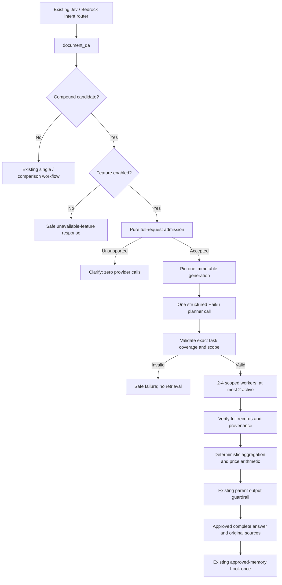

# Handoff PRD: Answer multi-part document questions with a bounded workflow

**Status:** Local implementation and the approved offline checks completed on 2026-10-13. The owner authorized this scope with “proceed.” The feature remains disabled by default. AWS writes, live inference, publication, and deployment remain outside this approval.

**Prepared:** 2026-10-13, Asia/Kuala_Lumpur.

**Audience:** The project owner and the engineer or coding agent implementing the next technical improvement for the AI engineering portfolio.

**Repository:** `C:/Users/kinoc/Documents/Codex/2026-09-28/i-x20/work/agentic-ai-langgraph-and-aws-agentcore`

**Inspected HEAD:** `081e0fb51d13cba9838ca5bf01762997ddef79ef`.

## 1. Outcome and definition of done

Build a document workflow that can answer a bounded request containing several related questions. It must identify every supported requested part, retrieve evidence separately for each part, and return one complete or explicitly partial answer with clickable original-document sources.

Example:

> Compare mushroom pasta prices at Harbor and Sakura, and explain both restaurants' cancellation policies.

The system will create four tasks: Harbor price, Harbor policy, Sakura price, and Sakura policy. It will retrieve each task within its own restaurant/document scope, validate the evidence, calculate a price difference when justified, and assemble one answer. One output guardrail and the existing approved-memory hook remain the parent workflow's responsibility.

This builds on the project's existing two-restaurant price comparison. The additional engineering work is mixed document-task planning, complete request coverage, bounded worker scheduling, policy evidence validation, and four-source approval/transport. The target is a controlled portfolio demonstration using fictional documents.

### Deliverables after sign-off

1. A separately gated multi-part subgraph within `document_qa`.
2. Strict admission, planner, task, coverage, evidence, and result contracts.
3. Deterministically rendered complete/partial answers with up to four original-document citations.
4. Credential-free tests and a separate offline evaluation dataset exercising the real new workflow with simulated dependencies.
5. Updated technical documentation, CI configuration, and an execution record mapping results to the acceptance criteria.

### Observable completion criteria

| ID | Required result | Required evidence |
| --- | --- | --- |
| AC01 | All five request forms in section 4 compile into the exact expected 2-4 tasks. Unsupported compounds clarify without pinning, planning, embedding, or selection. | Admission unit tests and dataset cases. |
| AC02 | One structured planner call is checked against independently compiled required tasks. Omissions, additions, duplicates, scope changes, and extra fields cannot reach retrieval. | Planner validation tests, exact operation counters. |
| AC03 | One pinned generation is used by every task; at most two workers run concurrently; all tasks share a deadline. | Pin counters, pointer-change fixture, concurrency barrier, deadline tests. |
| AC04 | Every supported task has one exact complete relevant record, verified provenance, and a server-created citation. | Independent quote/location/hash gold assertions. |
| AC05 | Cancellation evidence retains the complete timing and fee conditions; menu evidence retains qualifiers. | Truncated-record rejection and controlled policy-layout tests. |
| AC06 | A four-task supported request returns four working source references; three supported tasks out of four return an honest partial result. | Backend envelope tests and UI original-source tests. |
| AC07 | Price arithmetic uses validated `Decimal` facts and matching currency/units. Policy facts produce no inferred ranking or arithmetic. | Calculation and rendering tests. |
| AC08 | Invalid provenance rejects the entire answer; operational failures can produce a clearly marked partial answer. No requested task silently disappears. | Fault-injection tests and result-contract tests. |
| AC09 | Only the complete parent answer reaches output moderation, approved source release, and memory. Workers produce no public text or memory writes. | Parent-graph, streaming, masking/blocking, and memory tests. |
| AC10 | Existing single-document and comparison behavior remains valid. Feature disabled means no new planner calls. | Existing test suites and the original 17-case/20-case evaluations. |
| AC11 | New 40-case offline evaluation passes; reports distinguish simulated results from live performance. CI includes the new evaluator without cloud credentials. | Local JSON/Markdown reports, inspected workflow diff. |
| AC12 | Documentation records exact limits, local evidence, remaining approval gates, and any unmet criterion. | Updated documentation and execution record. |

Completion means local implementation and approved offline verification. It does not mean the running AWS application has received the feature. A remote CI result may be claimed only after separately authorized publication and inspection of that run.

## 2. Inspected baseline and continuity

These facts come from source/document inspection during PRD preparation. No application request or AWS readiness check was made for this PRD.

| Component | Existing behavior | Required extension |
| --- | --- | --- |
| `restaurant-finder-api/src/application/document_rag/workflow.py` | Dispatches comparison candidates before the single-restaurant path; buffers document responses. | Dispatch supported multi-part candidates before existing comparison detection. |
| `src/application/document_rag/comparison.py` | Parses bounded price requests and validates complete menu records and monetary facts. | Reuse pure menu validation/calculation; preserve comparison behavior. |
| `src/application/document_rag/comparison_workflow.py` | Uses `StateGraph`, `Send`, one manifest pin, two scoped workers, operation-owned retrieval sessions, deadlines, and single SDK attempts. | Follow its isolation pattern for 2-4 mixed tasks; do not call its complete workflow from a new worker. |
| `src/application/document_rag/retrieval.py` | Filters by generation, restaurant, and document type; checks vector/chunk provenance. | Supply one immutable manifest and one scoped query per task. |
| `src/domain/document_rag.py` | `DocumentCitation` permits Source 1-3. `RagOutcome` permits up to three citations; `partial` requires exactly one citation and no single restaurant scope. | Add explicit multi-part coverage validation and Source 4 without weakening old comparison rules. |
| `src/application/orchestrator/workflow/state.py` | RAG modes are `single` and `comparison`; approved scope is one restaurant. | Add `multipart` and transient validated coverage; clear approved scope after an approved multi-part turn. |
| `src/application/orchestrator/workflow/nodes.py` | Releases citations only after unchanged approved output; rejects more than three and non-comparison partial citations. | Check mode/coverage-specific caps and partial rules. |
| `src/application/orchestrator/streaming.py` | Resets transient RAG state and rejects more than three approved sources. | Reset new fields and validate four-source approved multi-part results. |
| `restaurant-finder-ui/source_documents.py` | Accepts Source 1-3, checks one generation/sequential labels, verifies originals, and supports PDF/Markdown viewing. | Accept exactly the bounded fourth source and preserve all existing verification. |
| `src/domain/prompts.py`, `src/deployment/sync_prompts.py`, `src/infrastructure/prompt_metadata.py` | Eight prompt objects are included in explicit deployment synchronization/manifest validation. | Add one planner prompt to both registries and manifest tests. |
| `.github/workflows/ci.yml` | Runs locked API/UI checks and two offline document evaluators; retains infrastructure/quality jobs. | Add the multi-part evaluator and reports to the existing API job. |

API paths beginning with `src/` above are relative to `restaurant-finder-api/`.

The existing corpus contains three fictional restaurants and six original documents. Harbor's menu is PDF; the policies and other menus are Markdown. No new corpus generation is necessary for this feature's local implementation.

Historical release documentation records Runtime/DEFAULT version 13 and six successful comparison validation requests on 2026-10-12. That live allowance was consumed. Historical release evidence does not establish current readiness or validate this new feature. The ambient browser URL `http://127.0.0.1:8010/` is not a readiness check.

At inspection, the worktree had one unrelated untracked file: `docs/HANDOFF_PRD_RUNTIME_WARNINGS.md`. Preserve it byte-for-byte. Its inspected SHA256 is `c3f491550280ba5568cea656d1e90378a76547ee5520e462a323469949aebf9f`. Runtime warning repairs remain a separate task.

## 3. Scope, tradeoffs, and fixed first-version limits

### Included

- One named menu item and cancellation policies.
- One or two distinct restaurants explicitly named through the registered catalog.
- Five completely parsed compound request forms, producing 2-4 tasks.
- One schema-constrained Haiku planner call after admission and pinning.
- A server coverage check against an independently compiled request envelope.
- Parallel scoped retrieval/selection, with maximum concurrency two.
- Exact menu records and complete supported cancellation-policy section bodies.
- Server-derived price comparison, deterministic answer assembly, and four-source viewing.
- Explicit partial/missing/unavailable/integrity failure behavior and safe tracing.
- Local tests, offline evaluation, and CI configuration changes after implementation approval.

### Deferred

- Arbitrary natural-language decomposition, open-ended agent loops, retries/replanning, and planner-created tools.
- More than two restaurants, more than one dish, other policy types, dietary decisions, and mixed real-web/fictional-document answers.
- Follow-up inference for a restaurant pair or a multi-part request using pronouns alone.
- Currency conversion, serving-size assumptions, policy rankings, discounts, taxes, and service-charge calculations.
- Document uploads, OCR, ingestion/schema migrations, vector/index changes, dependency upgrades, or new AWS resources.
- Benchmarks, live model/ranking validation, image builds, Docker recovery, prompt synchronization, deployment, Git publication, main-branch merging, demo walkthroughs, recording, and LinkedIn posting.

### Why a bounded model planner

The new planner proposes typed tasks, while server code independently checks that the request's supported parts are all represented. This makes model omissions observable and prevents retrieval under an invented scope.

The bounded grammar can also produce a deterministic plan without an LLM. Therefore, the planner adds a model call without expanding the accepted language in this first version. Its purpose here is a controlled, inspectable planning stage for the engineering demonstration. Do not claim it is necessary, cheaper, faster, or more accurate than deterministic planning. Removing it or expanding language coverage is a later design decision supported by evidence.

Jev remains the existing intent classifier with Bedrock fallback. Keep the four existing intents; do not ask Jev to emit this task schema or add a new orchestrator tool.

## 4. Request admission: exact supported forms

Implement a pure `is_multipart_candidate(question)` plus a pure `compile_multipart_request(question, catalog)`. Neither may construct a client or invoke a model.

Candidate detection must capture the new compound request family involving a price/item-price question and cancellation-policy question, including malformed ones, before `is_comparison_candidate`. A malformed new compound must not silently execute only its price clause. Preserve old single-purpose questions and price-only comparisons. Regression inspection identified two historical overlapping shapes that keep their old dispatch: `According to ... menu and policy ...` single questions, and `Compare ... prices and cancellation policy at ...` comparison clarifications. The latter retains its historical pin/clarification behavior; the zero-provider admission rule applies to the new request family.

The compiler accepts these templates. Angle-bracket values denote slots, not literal text:

| Form | Accepted request | Required tasks |
| --- | --- | --- |
| F1 | `Compare <item> prices at <A> and <B>, and explain both restaurants' cancellation policies.` | A price, A policy, B price, B policy. |
| F2 | `For <A> and <B>, compare <item> prices and their cancellation policies.` | Same four tasks. |
| F3 | `For <A>, what is the <item> price and cancellation policy?` | A price, A policy. |
| F4 | `What is the <item> price at <A>, and what is its cancellation policy?` | Same two tasks; `its` resolves only to A within this fully parsed request. |
| F5 | `Compare <item> prices at <A> and <B>, and explain <C>'s cancellation policy.` | A price, B price, C policy; C must equal A or B. |

Rules:

1. Normalize Unicode and whitespace, match case-insensitively, and consume the whole input. Reject more than 1,000 normalized characters; do not truncate before validation.
2. Permit registered names/aliases, singular/plural `price(s)`, optional `the` before the item, straight/curly possessive apostrophes, optional terminal punctuation, and one optional trailing `Show the sources.` sentence. Define these variations explicitly in tests.
3. Match aliases with word boundaries, preferring the longest alias. A and B must identify two distinct registered restaurants. C in F5 must identify a member of that same pair.
4. The item is 1-80 characters using the existing comparison item's permitted character set. Reject `and`/`or`, embedded venue names, policy terms, or an additional constraint that would create another task. Do not change the existing item's grammar globally.
5. Only F4's within-request pronoun is supported. Do not use `rag_approved_scope`, a previous answer, or memory to infer a multi-part restaurant.
6. Unknown restaurants, a third restaurant, two dishes, extra clauses, ingredient/allergy constraints, and incomplete scope return `clarify`. Render a fixed explanation and one accepted example. No pin, planner, embedding, vector query, or selector call is allowed.
7. Build required task identities independently of the model: `(restaurant_id, criterion, canonical_item_or_none)`. Preserve restaurant first-appearance order; for each restaurant, order price before policy. Assign server IDs `task-1` through `task-N` after this ordering.
8. If local admission succeeds, pin once and verify that the pinned catalog agrees with all admitted restaurant IDs and aliases. A catalog disagreement fails closed; do not reinterpret the question under a different scope.

An accepted F1 Harbor/Sakura request has this canonical order:

| ID | Restaurant | Criterion | Retrieval filter |
| --- | --- | --- | --- |
| task-1 | `demo-harbor-pasta` | `menu_item_price`, item `mushroom pasta` | Harbor + menu + pinned generation. |
| task-2 | `demo-harbor-pasta` | `cancellation_policy` | Harbor + policy + pinned generation. |
| task-3 | `demo-sakura-table` | `menu_item_price`, item `mushroom pasta` | Sakura + menu + pinned generation. |
| task-4 | `demo-sakura-table` | `cancellation_policy` | Sakura + policy + pinned generation. |

Completion order must never determine task order or source numbering.

## 5. Runtime flow and trust boundaries



This uses the orchestrator/worker pattern supported by LangGraph: independent workers write results that are combined by a parent. `Send` and reducer state are already used in this repository's comparison graph. Use the installed, locked library rather than copying a newer documentation environment. See the primary [LangGraph workflow guide](https://docs.langchain.com/oss/python/langgraph/workflows-agents#orchestrator-worker).

The planner receives the current admitted request, known restaurant IDs/names, and allowed criteria. It receives no retrieved documents, conversation memory, tool registry, source URLs, or credentials. Document text enters only the quote selector as untrusted evidence. Workers return typed private results, not `AIMessage`s or streamed text.

## 6. Contracts and planner validation

Create `restaurant-finder-api/src/domain/document_multipart.py`. All new Pydantic models forbid extra fields. Validated plans/results should be frozen, using immutable tuples where appropriate.

| Contract | Required content and invariants |
| --- | --- |
| `MultipartRequest` | Admitted restaurant order, one canonical item, exact required task identities, count 2-4. Constructed by the compiler. |
| `PlannerTaskDraft` | `restaurant_id`; criterion enum `menu_item_price` or `cancellation_policy`; `item` required only for menu tasks. No IDs, generation, instructions, URLs, answers, or arbitrary retrieval query. |
| `MultipartPlanDraft` | Tuple of 2-4 draft tasks only. Schema validation is separate from semantic coverage validation. |
| `MultipartTask` | Server ID, registered restaurant ID/name, criterion, inferred document type, canonical requested item or null. |
| `MultipartPlan` | Exactly the compiler's task set in server order, pinned generation ID, maximum four tasks, no duplicate identity. Constructed only after validating the draft. |
| `MultipartTaskResult` | One known task ID, status `supported`, `missing`, `unavailable`, or `invalid`; fixed reason enum; verified evidence/selection only when supported; optional validated `PriceFact` for menu tasks. |
| `MultipartResult` | Plan-order result for every required task, exact coverage counts, coherent overall status, bounded rendered text, and sequential server citations from one generation. |

Example valid planner draft for F1:

```json
{
  "tasks": [
    {"restaurant_id": "demo-harbor-pasta", "criterion": "menu_item_price", "item": "mushroom pasta"},
    {"restaurant_id": "demo-harbor-pasta", "criterion": "cancellation_policy", "item": null},
    {"restaurant_id": "demo-sakura-table", "criterion": "menu_item_price", "item": "mushroom pasta"},
    {"restaurant_id": "demo-sakura-table", "criterion": "cancellation_policy", "item": null}
  ]
}
```

Compare the draft's task multiset against the compiler's required identities. Reject duplicates before set comparison. Require exact restaurant, criterion, item, and count agreement; never silently fill a missing model task or discard an extra one. Reorder a valid draft into server order. Model order is not authority.

Build retrieval queries in server code from the validated task: `<item> listed price at <restaurant>` or `reservation cancellation timing and fee policy at <restaurant>`. No model-generated query can change these scopes or instructions.

Malformed/semantically invalid drafts return `invalid_answer` with a fixed safe response and no retrieval. Planner timeout/provider failure returns `unavailable`. Do not repair, retry, fall back to an unvalidated plan, or invoke a second planner.

Add `RAG_MULTIPART_PLAN_PROMPT` to `src/domain/prompts.py`. Use `structured_chain` with `MultipartPlanDraft`, temperature zero, the configured extraction model, and `max_tokens=1000`. The currently inspected extraction model setting is `us.anthropic.claude-haiku-4-5-20251001-v1:0`; retain configuration-based model selection.

## 7. Worker bounds, isolation, and deadline behavior

Add `DOCUMENT_MULTIPART_ENABLED: bool = False` to configuration and its documented example. Existing `DOCUMENT_RAG_ENABLED` remains the outer gate. A compound candidate with the new flag off receives a fixed feature-disabled response without a new planner call. Old single/comparison paths remain active under their existing settings.

| Resource | New workflow limit |
| --- | --- |
| Restaurants / criteria / tasks | At most 2 / exactly the two allowed criterion types / 2-4 tasks. |
| Manifest pin | At most one pin attempt; one successfully pinned manifest is required before planning/retrieval. Zero attempts for rejected/disabled requests. |
| Planner | At most 1 invocation, 1,000 output tokens, no repair loop. |
| Planner deadline | At most 5 seconds and never beyond remaining parent time minus assembly reserve. SDK connect 3 seconds, read 5 seconds, total attempts 1. |
| Worker concurrency | At most 2 active per request; use an operation-local semaphore plus graph `max_concurrency=2`. |
| Worker phase | Shared deadline `min(now + 45 seconds, parent_deadline - 2 seconds)`. Queue waiting consumes this same budget. |
| Graph completion | Up to 250 ms of assembly reserve may account for queued rows after the shared worker deadline; it does not permit further provider operations. |
| Parent deadline | Existing configured RAG request timeout, maximum 60 seconds, measured from document-node entry. |
| Each task | At most 1 embedding, 1 vector query page, 5 hits/chunk reads, and 1 selector invocation. |
| All tasks | At most 4 embeddings, 4 vector queries, 20 chunk reads, and 4 selectors. Pin reads are separate. |
| Retrieval context | At most existing 9,000-character cap per task, 36,000 aggregate; preserve complete passages. |
| Selector | Existing 1,600-output-token cap; require exactly one selection for a supported task. SDK connect 3/read 20 seconds, total attempts 1. |
| Selected evidence | One complete record of at most 600 characters per supported task; never truncate to fit. |
| Final text / sources | At most 15,000 characters / 4 citations. |
| Original viewer | Existing 5 MiB maximum per original; at most four originals, bounded aggregate 20 MiB; retain existing source-fetch deadline. |

These are logical-operation maxima, not a dollar estimate or a promise of successful completion within 60 seconds. Model input/context and parent guardrail/memory/router operations have additional costs. Do not label the feature a cost reduction.

Each retrieval worker must create its own boto3 session inside its owning synchronous task, following `make_scoped_retriever`. Close only initialized operation-owned clients in `finally`. Use a fresh configured selector per task; do not share mutable model/chain instances between workers. Factories and a monotonic clock must be injectable for offline checks.

Use a stateless subgraph without a checkpointer. A request-local completion ledger may record validated task results before aggregation, allowing a deadline handler to include completed tasks and mark all unfinished/unqueued tasks `unavailable/deadline_exhausted`. Never share the ledger across requests or put raw worker evidence into parent checkpoint state.

Check the shared deadline before client construction and before every provider operation. Stop scheduling when exhausted. On timeout/cancellation, set the worker stop flag before releasing its scheduling slot. A synchronous SDK request already in flight cannot be forcibly cancelled by `asyncio.timeout`; bounded SDK timeouts and cooperative checks must prevent subsequent operations. Close clients when their owning synchronous operation exits. Do not report all network work as instantly stopped.

Do not nest `answer_comparison` inside a worker: it would pin again and create workers outside this task budget. Reuse pure helpers, not complete workflows. Do not call long-term memory or per-worker guardrails.

## 8. Evidence validation and aggregation

### 8.1 Shared provenance validation

Use the existing retriever and renderer checks: generation, restaurant, document type, document ID, source hash, text hash, canonical full chunk text, location, and pinned manifest/source relationship must all agree. Reject duplicate/foreign vector hits, fabricated chunk IDs, unsupported links, instruction-like source content, and non-contiguous or modified quotations.

Construct each `DocumentCitation` from the manifest's immutable original reference. Models never supply source paths or URLs. Assign labels only after task results are sorted, skipping unsupported tasks. Print exactly one existing `Source: Source N — ...` marker per citation so the viewer can validate the final answer.

### 8.2 Menu price tasks

Reuse the existing complete-menu-record validation. For the same requested dish, retain qualifiers such as allergens and availability. Do not allow a quote containing only the price when its complete record has more information.

Reuse `PriceFact` and `Decimal` parsing for supported RM/MYR per-serving/bowl/piece formats. A verified record with an unsupported monetary format can be displayed with an explicit comparability limitation, without fabricated numeric facts. Preserve existing price-conflict handling.

If refactoring a helper out of `comparison.py`, keep old public comparison functions compatible and exercise the existing tests unchanged. Do not introduce a second parser whose accepted formats diverge from the old one.

### 8.3 Cancellation-policy tasks

The current parser stores canonical chunk text and section/line metadata, but does not retain paragraph boundaries after grouping. Consequently, do not assume it is possible to reconstruct arbitrary original paragraphs from canonical chunks.

Support the current controlled policy layout only:

1. The source is Markdown, document type `policy`, and the section equals `Reservations and cancellation` after bounded case/whitespace normalization.
2. For that document/section, the pinned manifest has one complete chunk containing the section heading and its entire body. Verify the retrieved chunk against that manifest entry.
3. Strip only the anchored known Markdown heading from that verified full text. The remaining canonical full section body is the required record. It must be nonempty, at most 600 characters, and pass existing unsafe-content checks.
4. The selector must quote exactly that complete body. Reject an isolated fee sentence or any shortened conditional text as an invalid selection.
5. A section split across chunks, a body over 600 characters, another format/heading, or a missing section produces `missing/unsupported_policy_layout` or `missing/no_evidence` as appropriate. Do not add source downloads, OCR, truncation, or an ingestion migration to make it fit.
6. Distinct cancellation section bodies in multiple applicable policy documents for the same venue are conservatively conflicting: return an integrity/answer conflict, with no merged policy claims. Exact identical bodies can be treated as one record using a deterministic manifest document/chunk order. Require verified retrieved evidence for the selected record; never cite unretrieved manifest text.

The complete Harbor body contains both the 24-hour free-cancellation condition and the later RM20 fee. Sakura's complete body contains the 12-hour condition followed by the RM15 late fee. `Later cancellations` cannot be quoted alone because its time boundary is in the preceding sentence.

This validation is deliberately tied to the controlled corpus layout. It is not proof of semantic completeness for arbitrary restaurant documents or arbitrary policy formats.

### 8.4 Whole-answer status

| Task outcomes | Whole-answer status | Public behavior |
| --- | --- | --- |
| All required tasks supported | `answered` | All supported records and citations; justified price calculation. |
| At least one supported, at least one missing/unavailable, no invalid task | `partial` | State `Answered X of N requested parts`; include every task with its supported record or fixed reason. |
| None supported; all missing | `insufficient_evidence` | No facts/citations; state evidence is insufficient. |
| None supported; at least one operational failure | `unavailable` | No facts/citations; fixed failure reasons for required parts. |
| Any invalid task, provenance violation, or conflicting record | `invalid_answer` | Reject the entire factual answer, discard all public citations/quotes, and return fixed safe text. |
| Unsupported request | `clarify` | Accepted example, no provider calls. |
| New feature disabled | `disabled` | Fixed feature-disabled explanation, no new provider calls. |

Result contracts require one unique row for every task ID in plan order. Extra, duplicate, or missing worker rows are invalid; only the explicit deadline handler may construct unavailable rows for unfinished known tasks. No missing row may be silently ignored.

Render deterministically: menu-price records first in restaurant order, justified comparison sentence second, policy records next, and clear unavailable/missing notices for requested parts. Derive source labels using canonical task order, irrespective of rendered section order or completion timing. Do not run a free-form synthesis model.

Calculate a difference/cheaper venue only if both requested menu tasks are supported and both monetary facts share currency and unit. Otherwise state why that calculation is unavailable. Policy fees are not menu prices: never compare them to dish prices or announce a better cancellation policy.

### 8.5 Example expected contents

For the inspected local Harbor/Sakura fixtures:

- Harbor menu: `Mushroom pasta - RM32 per serving. Contains wheat and milk.`
- Sakura menu: `Mushroom pasta - RM36 per serving. Contains wheat and milk. Available at dinner only.`
- Application calculation: Harbor's listed dish price is RM4 lower per serving; retain Sakura's dinner-only qualifier.
- Harbor policy: the complete 24-hour/RM20 section body.
- Sakura policy: the complete 12-hour/RM15 section body.
- Four source markers and original viewers; exactly one citation per supported task.

For Harbor/Spice with the same requested dish, Spice has no mushroom-pasta record in the inspected fixture. With both policies and Harbor's price supported, return `partial`, coverage `3/4`, three citations, and no cross-venue price difference. An absent dish record means insufficient evidence for that price, not that the dish is free or unavailable in reality.

These are local fixture expectations, not newly observed AWS responses.

## 9. Citation, coverage, approval, and conversation contracts

Extend `DocumentCitation.label` with the literal `Source 4`; do not accept arbitrary source numbers. Keep all strict filename, hash, generation, format, page, section, and line validators.

Add shared coverage types to `src/domain/document_rag.py` to avoid circular imports:

- `RagTaskSummary`: known server task ID, restaurant ID, allowed criterion, task status, fixed reason, and source label only when supported. No raw evidence or planner prose.
- `RagCoverage`: 2-4 unique ordered task summaries, required/supported counts derived and checked against them, unique sequential supported source labels.
- Add optional outcome `mode` and `coverage`. `mode=None` retains legacy validation for current callers. New multi-part outcomes must explicitly use `mode="multipart"`.

Validate caps by mode: legacy/single at most three, comparison at most two, multi-part at most four. Keep the old partial-comparison condition of exactly one source and no single restaurant scope. Multi-part `answered` requires every task supported; multi-part `partial` requires `0 < supported < required`. Both require one citation per supported summary, coherent labels/generation, and `restaurant_id=None`. Outcomes outside answered/partial may not publish citations. `RagAnswerDraft` retains its existing maximum three selections; task validation narrows this to exactly one without loosening the old contract.

Add `multipart` to `rag_mode` and transient `rag_pending_coverage` / `rag_approved_coverage` fields. Reset them with pending/approved citations, counts, and mode at each turn boundary. Parent state receives only the completed answer, generation/status, safe summary, and citation metadata. The full plan, drafts, chunk text, worker models/clients, and private ledger remain inside the subgraph.

Extend output approval with one shared validation helper used by the node and final-turn extraction. Publish references only when output is approved and byte-for-byte unchanged. Revalidate mode/status/coverage/counts/labels/generation. Blocking or masking removes every citation and approved coverage value. Never release worker text before this check.

After any approved multi-part response, clear `rag_approved_scope`; this also applies to the one-restaurant compound forms. The next `What about its parking policy?` must clarify the restaurant, while an explicit `What is Harbor's parking policy?` retains the existing single-document path. A blocked turn must not overwrite the prior approved scope. This deliberately avoids remembering only the restaurant whose worker happened to succeed.

Keep the existing final-answer SSE envelope and source viewer. No new endpoint is required. Update the UI's citation label/list cap to four, preserving sequential numbering, exact markers, one generation, original hash verification, bounds, full original downloads, and per-answer identity. A source-fetch failure must show a bounded source error without resending the agent query or presenting unverifiable contents as verified.

## 10. Exact implementation sequence after sign-off

Execute the steps in order. At each checkpoint, record files changed and inspected evidence. Do not broaden scope to repair unrelated warnings, refresh AWS credentials, or publish changes.

### Step 0 — Confirm approval and preserve the worktree

1. Confirm the owner approved this PRD's local implementation and offline verification scope. PRD preparation alone is not approval.
2. Read applicable `AGENTS.md` instructions; inspect `git status --short`, branch, HEAD, and relevant current source.
3. Compare with this baseline. If related code has changed, reconcile this PRD with the new source before editing. Preserve unrelated owner work.
4. Record the warning PRD hash and verify it remains unchanged at completion.
5. Do not touch the running UI process, real `.env` files, AWS profile files, deployed prompt manifests, corpus pointer, Docker, or Git remote.

**Checkpoint:** Exact scope and clean ownership boundary recorded; no external actions performed.

### Step 1 — Implement pure admission and strict contracts

1. Add `src/domain/document_multipart.py` with request/draft/validated plan/task/result contracts.
2. Add `src/application/document_rag/multipart.py` for pure candidate detection, compilation, draft validation, policy record validation, aggregation, and rendering.
3. Implement F1-F5, whole-input consumption, alias ordering, item/length rules, and exact coverage comparison.
4. Extract a small pure menu-record helper only if needed; retain compatibility wrappers for existing comparison callers.
5. Add contract/admission tests before orchestration integration. Ensure rejected forms cannot invoke injected provider factories.

**Checkpoint:** Accepted requests have a reproducible complete task list; malformed/incomplete drafts fail before retrieval.

### Step 2 — Add planner/configuration and prompt metadata compatibility

1. Add the disabled-by-default flag in `src/config.py` and document it in the API `.env.example`; do not edit real `.env` files.
2. Define `RAG_MULTIPART_PLAN_PROMPT` with allowed task schema, complete coverage requirement, untrusted-input handling, and no tools/facts/URLs.
3. Implement an injectable planner factory using configured extraction model, token cap, and construction-time SDK limits. Verify no hidden chain/model retries are added.
4. Add the prompt to the explicit imports/tuples in `src/deployment/sync_prompts.py` and `src/infrastructure/prompt_metadata.py`; update the latter's eight-prompt description.
5. Update prompt-management/metadata tests with complete nine-prompt synthetic manifests and missing/new-prompt/hash-mismatch failures.
6. Preserve startup's read-only manifest behavior. Do not skip required manifest validation because the new feature flag is false.

**Packaging consequence:** An old eight-prompt manifest will not describe the new code's ninth prompt. Even a deployment with the feature disabled needs an authorized prompt-sync/packaging plan or another explicitly reviewed compatibility design. Do not run the sync command or overwrite sealed release artifacts in this local phase.

**Checkpoint:** Planner is injectable; local offline imports do not contact AWS; future manifest requirements are explicit.

### Step 3 — Build the bounded stateless subgraph

1. Add `src/application/document_rag/multipart_workflow.py`, following the comparison graph's dependency-injection and scoped factory pattern.
2. Admit locally, pin once, validate pinned catalog agreement, invoke the planner once, and validate exact draft coverage.
3. Dispatch validated tasks with `Send`; use a reducer for typed task results, request-local semaphore two, and shared monotonic deadlines.
4. Build server queries and document-type filters; pass the same manifest object/generation to all workers, with `max_pages=1` and top-k at most five.
5. Select once only when eligible evidence exists. Apply menu/policy validation and existing provenance/source rendering.
6. Record validated results in the request-local completion ledger. On deadline, preserve completed results and create explicit unavailable rows for all unfinished known tasks.
7. Handle invalid evidence, provider errors, schema errors, cancellation, and client closure using fixed reasons. No repair loops or nested complete comparison workflow.
8. Aggregate deterministically into a typed `MultipartResult` and `RagOutcome(mode="multipart")`.

**Checkpoint:** One pin, complete task coverage, maximum two active workers, bounded operation counts, and honest partial failure are observable offline.

### Step 4 — Integrate parent dispatch and approval contracts

1. In `workflow.py`, compute mode once; dispatch compound candidates before price-only comparison, preserving old paths and disabled gates.
2. Pass the document-node deadline through pin/planner/workers rather than restarting a timeout for each phase.
3. Add the shared coverage types and mode-specific `RagOutcome` validation in `document_rag.py`.
4. Update orchestrator `state.py`, output approval in `nodes.py`, and turn resets/final extraction in `streaming.py`.
5. Keep completed document answers marked as buffered document RAG responses; suppress every intermediate planner/worker token.
6. Test exact/blocked/masked approval, four-source release, multi-part scope clearing, old comparison scope behavior, and one approved final memory save.

**Checkpoint:** All public sources derive from one completed approved answer; no worker state is written into conversation history or approved memory.

### Step 5 — Extend the original-document viewer

1. Update `restaurant-finder-ui/source_documents.py` for Source 4 and a four-citation maximum; preserve the existing strict validators and fetch bounds.
2. Verify `app.py` still attaches metadata only to the complete final response, without enabling citations for partial transport chunks.
3. Extend `tests/test_source_documents.py` using synthetic original bytes and fake stores: one PDF plus three Markdown originals, four sequential sources, and late source-fetch failure.
4. Test old one/two/three-source answers, retained references after another answer, duplicated labels, mixed generations, malformed metadata, wrong original hashes, and a fifth source rejection.
5. Verify each supported task's control opens its own original with the cited page/section/lines and offers its actual original download. Do not build a new document viewer.

**Checkpoint:** Four references work through simulated UI/source integration; no running AWS-mode browser demonstration is performed.

### Step 6 — Add safe observability

1. Reuse `rag_span` for `rag.multipart.plan`, `rag.multipart.worker`, and `rag.multipart.aggregate`.
2. Record bounded attributes: task ID/type, restaurant ID, generation ID, required/supported counts, fixed status/reason, and logical operation counts.
3. Do not log raw user questions, model drafts, document quotations, signed URLs, credentials, source bytes, or provider error bodies.
4. Ensure disabled telemetry is a no-op. Tests must demonstrate safe error class/status visibility without payload leakage.

**Checkpoint:** Trace relationships and coverage can be inspected without adding new cloud instrumentation or exposing text.

### Step 7 — Add regression tests and a separate evaluator

1. Add `tests/test_document_multipart.py` covering pure contracts, planning, worker concurrency, deadlines, provenance, aggregation, and parent graph integration.
2. Extend existing citation/prompt/UI tests instead of replacing their old assertions.
3. Add `src/evaluation/document_multipart.py` and `src/evaluation/datasets/document_multipart.json` with the 40 cases in section 11.
4. Run the real admission/subgraph/renderer under simulated pin/planner/embeddings/vectors/selectors/guardrails/memory. Use existing offline adapters where suitable. Fail if a cloud client is constructed outside an injected fake.
5. Separate provider simulation from independently authored expected tasks, quotes, coverage, statuses, arithmetic, and citations. Do not derive gold by calling the implementation under evaluation.
6. Produce JSON and readable Markdown including every case, coverage/provenance checks, logical calls, and fixed failures. Nonzero exit on any failed case or invalid dataset.
7. Test scorer mutation failures: dropped task, fabricated coverage, incorrect arithmetic, wrong quote/source, and leaked unsafe payload must cause failure.

**Checkpoint:** Offline success cannot be obtained merely by accepting the model's own task list or counting its citations.

### Step 8 — Extend CI without dispatching it

1. Add a third evaluator command to the existing API job in `.github/workflows/ci.yml`.
2. Append its `.md` report to the existing summary and allowlist its `.json`/`.md` in the existing API artifact.
3. Keep pinned actions, read-only repository permissions, locked environments, no cloud secrets, and existing infrastructure/quality jobs.
4. Set explicit feature enablement only inside the new offline fixture/test setup. Do not enable live multi-part requests through global CI environment defaults.
5. Inspect workflow paths and shell syntax. Do not edit or dispatch deployment/destruction workflows or enable additional GitHub settings.

**Checkpoint:** The proposed CI change is reviewable locally; no remote CI claim is made.

### Step 9 — Execute the approved offline checks

Use section 12's isolated process environment and exact commands. Fix failures within this PRD's scope and rerun affected checks plus the final API/UI suites and all three evaluators. Never weaken gold, skip a failing old case, or mark an unrun check as passed.

**Checkpoint:** Record actual commands, exit codes, test/case counts, and output report paths. Clearly label simulated provider results.

### Step 10 — Update docs and report against acceptance criteria

1. Update `docs/DOCUMENT_RAG.md` with supported compound forms, flag, data flow, policy-layout limitation, task/call/time limits, coverage behavior, and four-source semantics.
2. Update `docs/CI_AND_RAG_EVALUATION.md` with the new independent dataset and local command.
3. Update relevant README sections concisely; do not claim production readiness, measured savings, or deployed support.
4. Add an execution record to this PRD listing AC01-AC12 as passed, failed, or unverified with direct evidence.
5. Inspect final diff/status, confirm the unrelated warning PRD hash, and report all validation gaps.
6. Stop after the local handoff. Present implementation changes and offline evidence for review. Prepare a separate publication/rollout PRD only if the owner requests it.

**Checkpoint:** Local implementation is concrete and reviewable, with no silent AWS rollout or demo walkthrough.

## 11. Required offline evaluation cases

The dataset must contain these 40 distinct cases. Synthetic faults/variants are test inputs, not changes to the actual corpus. Specify exact planner/worker scripts and independent expected call counts for each case.

| Case | Scenario | Required assertion |
| --- | --- | --- |
| M01 | F1 Harbor/Sakura four tasks | Answered 4/4, four sources, RM4 difference, all exact records. |
| M02 | Reversed restaurant order | Server task/source order follows request, not worker timing. |
| M03 | Registered aliases, case/spacing/apostrophe variations | Same scope/tasks; full input consumed. |
| M04 | F3 and F4 single-venue compound | Two tasks/sources; scope cleared after approval. |
| M05 | F5 price pair plus one venue policy | Exactly three tasks/sources, no invented second policy task. |
| M06 | F2 with Sakura dinner qualifier | Full requested menu record retained. |
| M07 | Harbor/Spice, missing Spice mushroom pasta | Partial 3/4, three sources, no price difference. |
| M08 | F5 with missing one price | Partial 2/3, requested policy preserved. |
| M09 | Empty evidence for every task | Insufficient evidence, no selectors/citations. |
| M10 | Provider failures for every task | Unavailable, every required task accounted for. |
| M11 | One policy provider error, other tasks supported | Partial 3/4, fixed unavailable reason, three sources. |
| M12 | Mixed missing/provider failures, none supported | Unavailable, no facts or sources. |
| M13 | Shared deadline expires with completed and queued work | Completed rows retained; unfinished rows unavailable; no new operations after stop. |
| M14 | Unknown restaurant | Clarify; zero pin/planner/retrieval/selection. |
| M15 | Third restaurant including F5 C outside pair | Clarify; no silently dropped venue. |
| M16 | Two requested dishes | Clarify; zero provider calls. |
| M17 | Extra cuisine/ingredient/allergy constraint | Clarify; no ignored constraint. |
| M18 | Unscoped pronoun compound with old approved scope | Clarify; no inherited multi-part scope. |
| M19 | More than 1,000 normalized characters | Clarify; no truncation into accepted input. |
| M20 | Extra trailing clause/directive | Clarify except the explicitly allowed source sentence. |
| M21 | Planner duplicates a task | Invalid answer before embedding/selection. |
| M22 | Planner omits a policy task | Invalid answer before retrieval; no invented completion. |
| M23 | Planner changes/adds a restaurant | Invalid answer before retrieval. |
| M24 | Planner changes a policy task to menu | Invalid answer before retrieval. |
| M25 | Planner changes the requested item | Invalid answer before retrieval. |
| M26 | Planner adds URL/instructions/extra fields | Schema failure; no public payload or retrieval. |
| M27 | Planner timeout/provider failure | At most one pin/planner; unavailable; no worker calls. |
| M28 | Chunk text/hash mismatch | Entire answer invalid; all citations discarded. |
| M29 | Wrong-generation evidence | Entire answer invalid. |
| M30 | Wrong restaurant metadata | Entire answer invalid. |
| M31 | Wrong document type metadata | Entire answer invalid. |
| M32 | Quote only the late-fee policy sentence | Reject incomplete policy selection; no fee-only answer. |
| M33 | Quote menu price but omit record qualifier | Reject incomplete menu selection. |
| M34 | Conflicting complete policies | Entire factual answer invalid. Include long/split policy layout as missing-layout test variants. |
| M35 | Conflicting requested menu prices | Existing conflict rejection preserved. |
| M36 | Supported prices with incompatible units/format | Exact evidence displayed; no unsupported arithmetic/ranking. |
| M37 | Instruction-like text in selected source | No leaked instruction or secret; invalid selection. |
| M38 | Active pointer changes after pin | Exactly one pin; every source remains in the pinned generation. |
| M39 | New feature or outer RAG flag disabled | No planner/worker calls; safe disabled response. |
| M40 | Old single question and price-only comparison | Existing dispatch, semantics, and caps retained; no planner call. |

A case may have multiple deterministic variants; the report must not inflate the dataset count by relabeling checks as independent cases. Add unit tests beyond these cases for semaphore overlap, cancellation cleanup, five-source rejection, partial coverage corruption, guardrail mask/block, one memory save, private checkpoint state, telemetry hygiene, and source-viewer verification.

## 12. Exact local verification commands after approval

This section specifies future verification. No commands in this section were executed to prepare the PRD. Do not use these commands against the running AWS-mode UI or with real providers.

Run in a fresh PowerShell process so temporary environment settings do not modify the user's shell/session. Use locked, existing interpreters; no package upgrade or dependency installation is part of this PRD. If an interpreter/dependency is missing, report that gap and obtain scope for environment repair.

```powershell
$env:AWS_EC2_METADATA_DISABLED = 'true'
$env:AWS_REGION = 'us-east-2'
$env:PROMPT_SYNC_MODE = 'false'
$env:REQUIRE_PROMPT_MANIFEST = 'false'
$env:AGENT_OBSERVABILITY_ENABLED = 'false'
$env:EVALUATION_ENABLED = 'false'
$env:LOGURU_LEVEL = 'ERROR'
$multipartOfflineRoot = 'C:\Users\kinoc\Documents\Codex\2026-09-28\i-x20\work\agentic-ai-langgraph-and-aws-agentcore\restaurant-finder-api\.generated\evaluation'
$multipartManifestSentinel = Join-Path $multipartOfflineRoot ('no-manifest-' + [guid]::NewGuid().ToString() + '.json')
if (Test-Path -LiteralPath $multipartManifestSentinel) { throw 'Offline manifest sentinel must not exist' }
$env:PROMPT_MANIFEST_PATH = $multipartManifestSentinel
```

Factories must still enforce `cloud_clients_forbidden`; environment settings alone do not prevent AWS calls. Keep the new flag false in the process defaults; new test/evaluator fixtures explicitly patch it true and inject every provider.

From `restaurant-finder-api`:

```powershell
.\.venv\Scripts\python.exe -m unittest discover -s tests -q
.\.venv\Scripts\python.exe -m src.evaluation.rag --offline --output .generated/evaluation/document-rag.json
.\.venv\Scripts\python.exe -m src.evaluation.document_comparison --offline --output .generated/evaluation/document-comparison.json
.\.venv\Scripts\python.exe -m src.evaluation.document_multipart --offline --output .generated/evaluation/document-multipart.json
```

Run separately and inspect each exit code; stop on failure before claiming final completion. Reports must show the existing 17 single-document cases and 20 comparison cases are retained and all new 40 cases pass. Record actual unit-test counts, not historical totals or planned estimates.

From `restaurant-finder-ui`, use that component's existing locked interpreter:

```powershell
.\.venv\Scripts\python.exe -m unittest discover -s tests -q
```

From repository root, inspect the final diff and worktree status, the changed workflow and documentation, and the preserved warning file hash. No benchmark, live API request, browser submission, Docker image build, or infrastructure command is required for local acceptance.

## 13. File-level change map

| File, relative to repository root | Planned change |
| --- | --- |
| `restaurant-finder-api/src/domain/document_multipart.py` | New strict task/plan/result contracts. |
| `restaurant-finder-api/src/application/document_rag/multipart.py` | Pure admission, coverage checks, policy validation, aggregation/rendering. |
| `restaurant-finder-api/src/application/document_rag/multipart_workflow.py` | New bounded stateless subgraph and provider factories. |
| `restaurant-finder-api/src/application/document_rag/comparison.py` | Only a small compatible pure-helper refactor if required. |
| `restaurant-finder-api/src/application/document_rag/workflow.py` | Mode selection, compound dispatch, shared deadline, completed outcome integration. |
| `restaurant-finder-api/src/domain/document_rag.py` | Source 4, shared coverage summaries, mode-specific outcome validation. |
| `restaurant-finder-api/src/config.py`, `.env.example` | Default-off feature flag; the example path is inside the API component. |
| `restaurant-finder-api/src/domain/prompts.py` | One structured planner prompt. |
| `restaurant-finder-api/src/deployment/sync_prompts.py` | Register new prompt; edit only, no execution. |
| `restaurant-finder-api/src/infrastructure/prompt_metadata.py` | Include ninth prompt in read-only validation. |
| `restaurant-finder-api/src/application/orchestrator/workflow/state.py` | Multi-part mode and transient safe coverage. |
| `restaurant-finder-api/src/application/orchestrator/workflow/nodes.py` | Validated complete/partial citation approval and scope behavior. |
| `restaurant-finder-api/src/application/orchestrator/streaming.py` | Transient reset and final approved contract checks. |
| `restaurant-finder-ui/source_documents.py` | Bounded four-source validation and existing viewer integration. |
| `restaurant-finder-api/tests/test_document_multipart.py` | New unit/integration tests. |
| Existing API citation/prompt tests; UI `tests/test_source_documents.py` | Add compatibility and four-source checks; preserve old cases. |
| `restaurant-finder-api/src/evaluation/document_multipart.py` | Real-workflow offline evaluator and independent scorer. |
| `restaurant-finder-api/src/evaluation/datasets/document_multipart.json` | New 40-case dataset. |
| `.github/workflows/ci.yml` | Third offline evaluator, summary, report artifact paths. |
| `docs/DOCUMENT_RAG.md`, `docs/CI_AND_RAG_EVALUATION.md`, relevant README | Technical capability, limitations, and reproducible checks. |
| This PRD | Append actual execution record after approval. |

Do not add a new infrastructure stack, vector index, API endpoint, tool registration, dependency, or general planning framework. If a material source change outside this map becomes necessary, explain the reason and reconcile scope before doing it.

## 14. Authorization and future rollout

| Action | Authorized by current request? | Later boundary |
| --- | --- | --- |
| Inspect source/docs and write this PRD | Yes. | Completed in preparation. |
| Implement API/UI/config/test/CI documentation changes | Yes, owner approved on 2026-10-13. | Local implementation completed. |
| Execute the explicit credential-free local checks | Yes, included in the 2026-10-13 sign-off. | Final local checks completed; evidence below. |
| Restart the UI or submit a real browser/API question | No. | Separate local/live validation decision. |
| AWS prompt sync, ECR writes, builds/deployments, flag enablement | No. | Separate concrete publication/rollout PRD and explicit approval. |
| New Jev/Bedrock/embedding/guardrail calls against real services | No. | New bounded call budget; previous six-call rollout allowance is exhausted. |
| Commit/push, create/merge PR, publish CI changes | No. | Separate publication authorization. |
| Docker restart/cleanup or AWS credential/IAM repair | No. | Separate specific recovery approval if needed. |
| Demo walkthrough, video, benchmark, LinkedIn posting | No. | Deferred by owner preference. |

The later rollout must handle the ninth prompt's immutable manifest, an ARM64 image, runtime configuration for the new default-off flag, backward-compatible four-source transport, and a newly approved live validation budget. Preserve the current corpus and provide a recoverable prior image/configuration reference. Do not reuse a historical release receipt as new evidence.

## 15. Assumptions, open decisions, and execution record

### Chosen assumptions for review

- Begin with one item plus cancellation policies, five bounded forms, maximum four tasks, and concurrency two.
- Use the current configured extraction model for one inspected structured planner stage; Jev routing remains unchanged.
- Support complete cancellation-section bodies in the existing controlled Markdown layout; general policy parsing is deferred.
- Keep the feature disabled by default and accept local simulated verification before any live work.
- Clear single-restaurant follow-up scope after every approved multi-part response.

These choices can be adjusted during PRD review. There is no missing credential or AWS access answer required to prepare or implement the offline feature.

### Decisions needed only for a later phase

1. Whether to retain the model planner, remove it for deterministic planning, or expand its accepted language after measuring correctness.
2. Whether and when to publish/deploy; approve the prompt-manifest/configuration change and fresh live-call allowance then.
3. Whether to generalize policy structure or add new task types after this bounded feature works.

### Preparation record

- Source, contracts, controlled policies, CI configuration, prompt tooling, and existing PRDs were inspected.
- The cited LangGraph primary documentation was consulted for the worker pattern.
- This PRD is the only new requested deliverable from this preparation task.
- During PRD preparation, implementation, tests, evaluations, application submissions, model calls, AWS operations, Git publication, and deployment were not performed. The subsequent approved local work is recorded below.

### Implementation record — completed locally, 2026-10-13

**Approval and stopping point.** The owner's “proceed” authorized this PRD's local source/document changes and explicit credential-free checks. Implementation and local acceptance are complete. No running application was restarted or submitted a question. No AWS operation, real provider inference, Docker operation, commit, push, PR publication, remote CI dispatch, benchmark, or demo walkthrough was performed in this phase. Both feature gates remain unchanged in real environment files; the new gate defaults to false in code and the example.

**Repository continuity.** Starting and final HEAD are `081e0fb51d13cba9838ca5bf01762997ddef79ef` on `feat/jev-router`. All implementation changes remain uncommitted. The unrelated owner file `docs/HANDOFF_PRD_RUNTIME_WARNINGS.md` retains its starting SHA-256: `C3F491550280BA5568CEA656D1E90378A76547EE5520E462A323469949AEBF9F`. Original corpus files, the original two evaluation datasets, real `.env` files, dependency manifests/locks, and sealed release artifacts were not edited. The temporary dataset-authoring helper was removed; the requested static dataset and ignored reports remain.

**Changed files.** The six new API files are the three multi-part contract/workflow modules, `src/evaluation/document_multipart.py`, its `datasets/document_multipart.json`, and `tests/test_document_multipart.py`. Existing API changes are the compatible menu helper, document dispatch, outcome/coverage contracts, configuration/example, planner prompt, synchronization registration, read-only prompt validation/tests, and parent state/approval/streaming. UI changes are four-source validation/budgeting and original-source tests. CI adds the third offline evaluator and its two allowlisted report files. README, the document/evaluation guides, and this PRD record the feature and limits. These are the paths mapped in section 13; no infrastructure or dependency change was needed.

**Reconciled details.** New-family malformed compounds reject before provider operations. Two historical request shapes retain their existing routes: `According to ... menu and policy ...` stays single-document; `Compare ... prices and cancellation policy at ...` stays the comparison clarification route, including that route's existing pin behavior. This qualification preserves AC10 rather than silently changing old curated cases. Workers stop provider operations at their shared deadline; a maximum 250 ms graph-accounting grace consumes the existing assembly reserve so queued tasks receive explicit results. Neither adjustment expands supported criteria, model calls, retries, or the parent deadline.

**Final verification.** Checks ran with the components' existing locked `.venv/Scripts/python.exe` interpreters in the isolated process environment in section 12. AWS metadata lookup, prompt synchronization, observability, and live evaluation were disabled; the manifest path was a verified nonexistent sentinel. Fake providers exercised the real new workflow and retrieval/validation paths, without cloud credentials or network calls.

| Component / working directory | Command after the locked interpreter | Exit | Inspected result |
| --- | --- | --- | --- |
| API | `-m unittest discover -s tests -q` | 0 | 196 tests, OK. |
| UI | `-m unittest discover -s tests -q` | 0 | 31 tests, OK. |
| API original RAG | `-m src.evaluation.rag --offline --output .generated/evaluation/document-rag.json` | 0 | 17/17 observed, complete/pass, 374 measured checks, no failed/missing cases. |
| API comparison | `-m src.evaluation.document_comparison --offline --output .generated/evaluation/document-comparison.json` | 0 | 20/20 observed/pass, 260 measured checks, no failed/missing cases. |
| API multi-part | `-m src.evaluation.document_multipart --offline --output .generated/evaluation/document-multipart.json` | 0 | 40/40 observed/pass, 609 measured checks, no failed/missing cases. |
| Repository | `git diff --check` | 0 | No whitespace errors; existing Windows line-ending notices are not failures. |
| CI static inspection | Parse YAML and compare jobs, permissions, action pins, evaluator command and artifact paths against HEAD | 0 | Existing four jobs, `contents: read`, and pinned actions unchanged; new evaluator/reports present. No remote run claimed. |

Reports are saved locally in `restaurant-finder-api/.generated/evaluation/`: `document-rag.json`/`.md`, `document-comparison.json`/`.md`, and `document-multipart.json`/`.md`. Each evaluation explicitly identifies `offline_regression` and `simulated_dependencies`. Reports are ignored local artifacts, not published CI evidence. Intentional fake-provider failure logs in fault-injection tests do not indicate failed tests. The existing UI MCP configuration warning remains outside this feature's scope.

| Acceptance criterion | Local result and inspected evidence |
| --- | --- |
| AC01 | Pass for the new request family: all five forms, aliases/order, one-venue pronoun, size limits and malformed requests are exercised. The historical compatibility exception is explicit above and in section 4. |
| AC02 | Pass: schema extras and missing/duplicate/added/changed planner tasks fail before retrieval; exact planner/retrieval counters are checked. |
| AC03 | Pass: one pin under pointer change; a four-task overlap barrier enforces maximum two; controlled-clock and actual asynchronous timeout tests preserve completed rows, stop further operations and close owned clients. |
| AC04 | Pass offline: independent full quote/location/hash gold and real provenance-boundary fault injection; every released source is server-created from the pinned generation. |
| AC05 | Pass: adjacent menu qualifiers and full cancellation timing/fee conditions retained; truncated, split, oversized and conflicting records exercised. |
| AC06 | Pass offline: four-source answered envelope and 3/4 partial result; UI tests load hash-verified original PDF/Markdown bytes, page/line controls and downloads. A late fourth-source failure retains the first three. No live browser click is claimed. |
| AC07 | Pass: validated `Decimal` price difference, ties and incompatible units/formats; supported prices may be compared even when a policy fails; no policy ranking or fee arithmetic. |
| AC08 | Pass: invalid evidence discards public facts/citations; provider/deadline failures account for every required task and preserve supported parts. |
| AC09 | Pass: one parent moderation/memory operation, unchanged-only citation/coverage release, masked/blocked handling, per-turn resets and no private worker plans/evidence in parent checkpoints. |
| AC10 | Pass: final API/UI suites and all original 17/20 curated cases retained; new/outer disabled gates make no new planner calls; legacy source and scope controls remain covered. |
| AC11 | Pass locally: all 40 new cases and 609 measured checks; CLI failure/invalid-input paths exercised; CI YAML/static contract inspected. Live accuracy, ranking, latency/cost and remote CI are unmeasured. |
| AC12 | Pass: guides/README/PRD document grammar, resource limits, controlled policy layout, ninth-prompt packaging consequence, local results and future approval boundaries. |

No required local acceptance criterion remains unmet. Live Jev routing, Haiku planner/selector accuracy, semantic ranking, deployed four-source transport, browser behavior against the running service, latency, and cost remain unverified. A future rollout requires separate publication/deployment authorization, a nine-prompt immutable manifest, reviewed image/configuration/UI changes, and a fresh bounded live-call allowance; the historical six-call budget is not reused.
